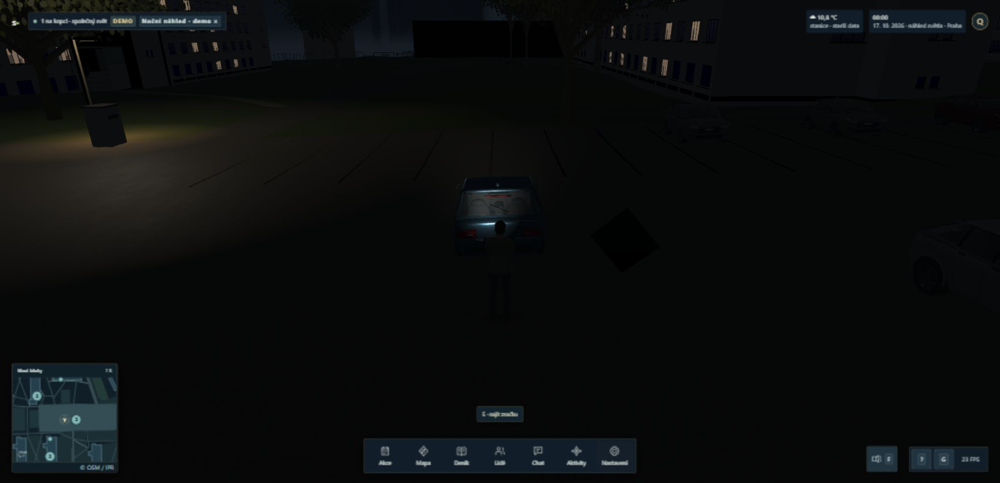

# Příprava nočních světelných variant — 16. 10. 2026

Navazuje na samostatně publikované opravy `114389e` a `9d98ffc`. Finální zdrojový snapshot je **3593bd1d46b70aa6591e527e7caf47c7eb617d5dd34ae53967c063ad25f24a56**: 8 406 vstupů včetně 165 testových souborů. Git metadata izolované worktree zůstala `2c7aec9`; identitu hraného kandidáta určuje tento obsahový manifest, nikoli starý HEAD.

## Mechanismus a rozhodnutí

První dvě opravy odstranily historii pořadí materiálových světelných slotů a rozpoznané glTF nafukování kapacity. První svítilna však stále měla 1 114,4 ms, převážně ve skutečném renderu. Proto nová příprava používá skutečné meshe, materiály, instancing, stíny a render před `Game.ready`, nikoli náhradní shader nebo dočasné spuštění herní smyčky.

První návrh současné/noční OFF–ON připravil první F, ale chůze ještě způsobila 851,9 ms. U nejbližší lampy `ipr2024-parking-south-central` je spawn vzdálený 28,43692 m a vzorkovaný kontext záseku 30,14935 m; skutečný cutoff je 30 m. Aktivní světla mezi snapshoty klesla ze tří na dvě. Přesný event vypnutí nebyl zaznamenaný, ale geometrie, změna počtu a následné zahřátí ukazují na chybějící POINT variantu.

Finální matice proto obsahuje současné OFF/ON, normální noční 0/1/2 skutečné pouliční lampy × OFF/ON a obnovení současného požadavku. Počty se omezují kvalitou a skutečně aktivními nepouličními světly. Používají se existující nejbližší lampy, se skutečnými polohami, dosahy a noční intenzitou. Dočasná příprava dalších počtů probíhá pouze pod načítací vrstvou. Herní výběr lamp, intenzity, geometrie ani pohyb se nemění.

Readiness je dávkovaná a doplněná skutečnými rendery i `engine.areAllEffectsReady()`, protože starý hot-swapped efekt není důkaz připravenosti nového. Jediný dočasný loop má nezávislý 30s watchdog a cancellation; dokončení končí okamžitě, bez čekání na deadline. Restore čte aktuální nastavení. Rozpočet glTF se synchronizuje před pořadím světel, včetně přechodu ze čtyř na pět zdrojů. Nezávislé review a cílené regrese ověřily cleanup, změnu settings/avataru, chyby, timeout, jednotlivé počty i omezení low/moon.

Alternativy a primární Babylon 9.30 podklady: [výzkum a rozhodnutí](../../research-20261016/light-preparation.md), [původní světelný řetězec](../../research-20261015/night-flashlight.md). Trvale zapnutá nulová světla nebo změna dosahů by vyžadovaly jiný světelný/stínový rozpočet. Kontrola pouze dalších meshů mimo frustum neřeší doloženou změnu počtu lamp.

## Skutečné GPU výsledky

GTX 1060, ANGLE D3D11, CSS i interní rozlišení 2040 × 986, medium, reálný multiplayer a HUD. První F je první interakce v nové herní relaci; disková cache ovladače nebyla vymazaná. U spawn testů se shodují pozice, kamera, kvalita, astronomický instant 1792188000000 a zaznamenaná meteorologická pole. Okolní simulovaný provoz a zatížení hostu nejsou dokonale řízené. Čísla jsou 10s měření, nikoli příslib výkonu na jiném GPU.

| Běh | FPS | p95 ms | p99 ms | maximum ms |
| --- | ---: | ---: | ---: | ---: |
| Původní první F | 39,5 | 29,8 | 60,1 | 2389,7 |
| První F po prvních dvou opravách | 54,5 | 22,7 | 60,0 | 1114,4 |
| V3: příprava pouze aktuálního místa, první F | 30,6 | 54,2 | 67,2 | 182,7 |
| V3: první chůze přes hranici lampy | 41,8 | 43,0 | 60,2 | 851,9 |
| V4: rozšířená matice, první F | 51,6 | 31,2 | 39,5 | 155,2 |
| V4: první chůze přes hranici lampy | 52,4 | 31,9 | 36,7 | 54,4 |
| V5 finální: první F | 34,6 | 47,6 | 65,9 | 157,8 |
| V5 finální: opakované F | 32,7 | 45,9 | 86,7 | 269,8 |
| V5 finální: první chůze | 29,8 | 67,0 | 231,2 | 374,9 |
| V5: tři různé avatary, OFF/ON | 19,7 | 82,6 | 189,7 | 207,8 |

V4 a V5 runtime se liší pouze watchdogem 20 → 30 s; Game, guardy, shadery a assety jsou shodné. V4 příprava narazila na 20s limit při restore a **nebyla přijata jako complete**. V5 kompletně dokončila všech devět stavů za **16 385,6 ms**. To je skutečná práce přidaná do načítání. Celý interval `mode-change → game-ready` byl v této relaci **44 391,2 ms**, proti 15 750,6 ms u V1; rozdíl není čisté izolační měření přípravy, protože kolísala i doba původního načítání. Watchdog je 30 s a jednotlivé synchronní volání ovladače nelze přerušit uprostřed.

V5 první F se shoduje s V4, ale i při stání je základní render pomalejší (428 draws / 1 271 285 triangles v obou, mean render 16,19 → 24,12 ms). Série 152–375ms snímků při V5 pohybu má zvýšené simulation/environment/render fáze i čas mimo měřený callback, nikoli opakovaný izolovaný 830ms render na původní 30m hranici. Z dostupných logů nelze určit scheduling, GC, driver/GPU nebo jinou zátěž. Trasy mají stejné klávesové délky, ale odlišné koncové pozice kvůli rozdílnému průběhu snímků a síťové korekci. **V5 horší výsledky nejsou vyřazené. Neprokazujeme celkový FPS zisk ani obecnou plynulost.**

Dva další klienti použili skutečný SDK/protokol11, kompletní různé preset avatary a běžné session/input API, bez privilegované změny polohy. Všichni byli ve stejném světě; vlastní klienti se odpojili bez SDK chyb. Low → medium a den/noční smoke byly ověřované přes UI; nebyla hlášená renderová chyba, ale změna kvality měla i dlouhou pauzu. Tento startup nepřipravuje všechny později zvolené kvality.

## Důkazy a limity

- [Intervaly všech běhů, scény, renderer, počasí a SHA původních exportů](preparation-comparison.json).
- [Úplné výsledky přípravy a významné snímky z automatických logů](preparation-lifecycle.json). Originální JSON/JSONL jsou zachované mimo rotující collector v `.cache/night-flashlight-20261015/`.
- V2 selhal strict TypeScript kvůli neúplnému testovacímu `SmartArray`; opraveno skutečným `SmartArray` před novým buildem. V3 odhalila nepokrytý počet lamp, V4 timeout; nic z toho se nevydává za úspěšnou finální přejímku.
- Ruční tlačítko návratu na start způsobilo V5 pauzy 707/746 ms. Nejde o samovolný respawn. Opuštění hry má dále samostatný dlouhý teardown (KEY-20).
- Všechny finální benchmarky mají 0 renderových a 0 assetových chyb. Nízké FPS při třech avatarech zůstává skutečný nález.
- Příprava se týká aktivních materiálů při startu a uvedené matice. Neprokazuje všechny nové LOD, pozdější avatary, B6/interiéry, jiné astronomické sestavy ani nástup do auta. B6 průchod nebyl v této GPU sérii proveden. KEY-3/KEY-5 zůstávají otevřené pro zbytkové propady a širší přejímku.
- Bezpečnost: žádná nová síťová cesta, oprávnění, závislost, profilová data ani credentials. Diagnostický event má konečný počet technických čísel/stavů. Input, autority, predikce a adaptivní kvalita během přípravy neběží.
- Frozen uživatelský4188 zůstal neměnný. Vlastní preview4189/API2584, browserové scény a SDK klienti byly po měření ukončené. Plná CPU validace probíhá až po jejich ukončení.

## Finální automatické ověření

`pnpm test`: **959/959 PASS**,185,62s. `pnpm build`: strictTypeScript a produkčníVite PASS. `pnpm test:integration`: izolovaný2568, HTTP/SDK/protokol/pohybové manévry/input backlog PASS. Všech8406manifestovýchvstupů zůstalo po buildu i celé sadě shodných. [Manifest](v5-checkpoint.json), [build](v5-build.log), [testy](v5-test.log), [integrace](v5-test-integration.log), [časový záznam](v5-validation.jsonl). Očekávané bundler upozornění na velké chunky a smíšený dynamic/static import vegetace nezpůsobilo chybu; výstup je zachovaný.
