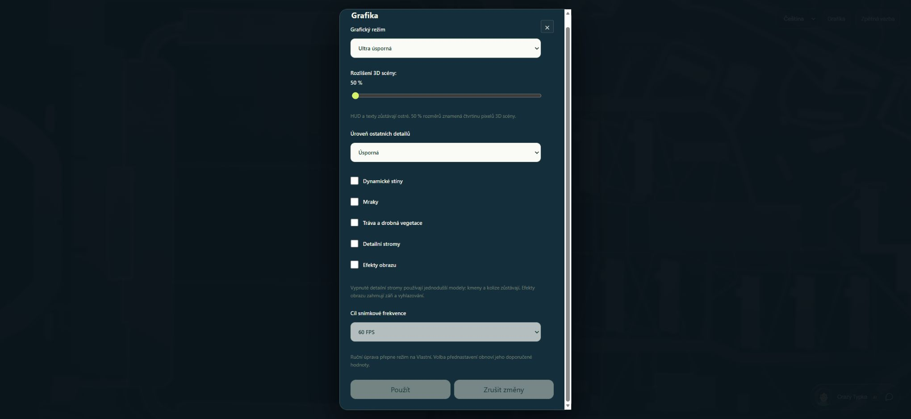

# Ultra grafika: aktuální výsledky

Aktuální [výkonové srovnání z5.listopadu2026](comparison-run3/README.md) má45/48 platných vzorků a kompletní tři Low/Ultra opakování pro oba pohledy. Ultra zkrátilo medián ve scenérii53,30→45,00ms (**15,57 %**, hranice20 % nesplněná). Největší samostatný přínos mělo vypnutí stínů; samotných50 % renderu přínos neprokázalo. Všechny použité záznamy mají správnou identitu, fokus, nastavení a validní render. Měření nezahrnulo aktivní drobnou vegetaci v tomto záběru a celková plynulost60FPS nadále neprošla. Živé přepínání testovaných Low/Custom/Ultra konfigurací je nyní prakticky doložené; B6/jízda/noční svítilna a WebGL2 smoke zůstávají samostatně nedokončené.

## Historický první pokus: run1

Implementace a samostatné zvýšení WebGL2 přípravy na 60 s jsou na větvi `codex/graphics-smoothness-20261104`, runtime checkpoint `e60d33a6796d6aacc8adf39e2ca8fae5baa3964a`. [PR41](https://github.com/Varnahg/StrahovCrazyShow/pull/41) zůstává draft: celková funkční a výkonová přejímka není dokončená.

| Kontrola | Skutečný výsledek |
|---|---|
| Plné CI na e60d33a6 | 3191 testů: 3189 PASS, 0 FAIL, 2 SKIP; produkční build a izolovaná multiplayerová integrace PASS. |
| Další CI | Feedback browser a source secret hygiene PASS. |
| Místní TypeScript a neměnný build | PASS; build 217,6 s včetně dvojí revalidace vstupů, samotné Vite sestavení 5,82 s. |
| Panel před vstupem | Skutečné UI použilo Ultra, Low detail, 50 %, vypnuté uvedené efekty, cíl 60 FPS. |
| Studený Game startup | WebGPU/NVIDIA, game-ready ve 22:20:00,694 UTC; CSS 1280×720, backbuffer 640×360; připojení dvou různých skutečných SDK avatarů doložené. |
| Výkonová matice | **0 z 48 plánovaných benchmarků.** Žádné pořadí přínosu jednotlivých voleb ani 20% zrychlení není prokázané. |
| Další runtime kontroly | Živé Apply, pohyb/B6/jízda/noční svítilna a WebGL2 smoke v této kampani neproběhly. |
| Cleanup | API, preview, sampler i SDK procesy ukončené, porty 2568/4179 volné, vstupy revalidované; původní 8080 zachované. Zavření konkrétní testovací karty následně potvrdil uživatel. |

Plné CI: [verify job](https://github.com/Varnahg/StrahovCrazyShow/actions/runs/41922418570/job/126898216253), [archiv logu](ci/e60d33a6-verify.log.gz). Jeho nekomprimovaný SHA-256 je `c652230fb3d5379085034046ffac6ff3b291e54eea180292947e8ead67b47550`. Předchozí neúspěšné CI pokusy a jejich konkrétní opravy zůstávají v [4ad9725d](ci/4ad9725d.json) a [c3854084](ci/c3854084.json); výsledky se nezaměňují za tento checkpoint.

Neměnný runtime má source/tests ID `74780b517048cdf304643486912d2921cd7dff88e6b0c5d7ad9007ce05b6f4c2`. [Úplný archiv a receipt](run1-interrupted/receipt.json) uchovává 935 záznamů session `021fdcd8-bfd5-4a2d-8100-e97eba3467a3`, systémovou telemetrii, manifest a cleanup. V logu jsou přibližně sekundové snímkové intervaly. Nezávislé ověření popředí okna se nedokončilo, proto se z nich nevyvozuje běžné FPS ani příčina záseků.

Computer Use při výběru nativního okna Edge nedokázal spolehlivě určit aktuální URL a bezpečnostně ukončil předchozí tah. Nebyl použit jiný ovládací kanál ani změna ochrany. Následná práce byla pouze mimo UI: archiv, ukončení vlastních procesů a ověření cleanupu. Raw lifecycle končí `visibility:hidden` bez potvrzeného dispose/pagehide; samotná neaktivita GPU a presence0 nebyly vydané za důkaz zániku scény. Uživatel nejprve potvrdil otevřenou kartu a poté její ruční zavření, čímž byla tato nejistota cleanupu uzavřená.

SDK peers byly řádně připojené, ale po zániku browserové přítomnosti skončil jejich monitor očekáváním porušené populace. Tento výsledek je zachovaný jako neúspěšný konec peers běhu, přestože jejich následný cleanup proběhl bez chyb. Nejde o nepřerušenou multiplayerovou přejímku.

Po bezpečnostním STOP nebyl obnoven původní testovací režim High/60 ani ověřen reset viewportu. Origin 4179 zůstal uložený v Ultra/50 %/60; produkční origin 8080 se neměnil. Obrázek níže dokumentuje jen předherní volby ještě před opravou viewport override, nikoli rozměr měřeného snímku.

Další validace musí vyjít z [předem určeného plánu](MEASUREMENT.md), čerstvě ověřeného ovládání a nové identity běhu. Dokončení této dokumentace ani zelené CI nejsou přijetím celkové plynulosti. Pro několikasekundové prodlevy se zatím netvrdí oprava.
