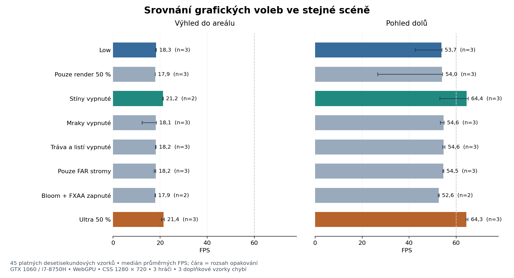

# Výkonové srovnání Ultra — 5. listopadu 2026

**Ultra zkrátilo medián snímku ve výhledu z 53,30 na 45,00 ms, tedy o 15,57 %. Předem stanovenou hranici 20 % nesplnilo.** Největší samostatný přínos v této scéně mělo vypnutí dynamických stínů. Samotné snížení renderu na 50 % přínos neprokázalo.

Pro tuto měřenou scénu je rozumným nastavením **Vlastní / Low, stíny vypnuté, render přibližně 77 %**. Ve dvou společných výhledových opakováních mělo 21,2 FPS oproti 21,6 FPS Ultra, při vyšším rozlišení a zachování ostatních voleb. Jde o místní doporučení z této scény, nikoli univerzální profil všech míst či počítačů.

## Výsledky

FPS jsou mediány průměrů desetisekundových vzorků. Čas snímku a p99 jsou mediány příslušných metrik jednotlivých vzorků; percentily se neslévají ani neprůměrují. Počet opakování je tři, kromě výhledu C a obou pohledů G, kde jsou dvě.

| Nastavení proti Low | FPS dolů | FPS scenérie | Medián snímku scenérie | p99 scenérie | Zlepšení mediánu proti párovanému Low |
|---|---:|---:|---:|---:|---:|
| A: Low | 53,7 | 18,3 | 53,30 ms | 78,80 ms | reference |
| B: pouze render 50 % | 54,0 | 17,9 | 54,00 ms | 81,10 ms | −1,31 % |
| C: stíny vypnuté | 64,4 | 21,2 | 45,75 ms | 71,50 ms | **+13,92 %**, n=2 |
| D: mraky vypnuté | 54,6 | 18,1 | 53,40 ms | 92,40 ms | −0,19 % |
| E: drobná vegetace vypnutá | 54,6 | 18,2 | 53,20 ms | 84,00 ms | +0,19 % |
| F: pouze FAR stromy | 54,5 | 18,2 | 53,60 ms | 92,20 ms | −0,56 % |
| G: bloom/FXAA zapnuté | 52,6 | 17,9 | 54,73 ms | 75,70 ms | −2,96 %, n=2 |
| H: Ultra 50 % | 64,3 | 21,4 | 45,00 ms | 77,60 ms | **+15,57 %** |

Malé rozdíly mezi B/D/E/F/G nejsou průkazné. V referenčním záběru se nevykreslovaly fotografické travní dlaždice ani opadané listí, takže E **neověřuje náklad scény s aktivní drobnou vegetací**. Rozlišení změnilo i stromové LOD: A mělo počty [0,2,108], B/F/H [0,0,110]; změnu B nelze připsat pouze počtu pixelů.

Párové zlepšení mediánu Ultra proti Low: **16,79 / 15,57 / 13,28 %**. Párové změny p99 Ultra−Low: **−2,4 / +2,3 / −14,5 ms**. Nezavádíme dodatečný práh pro „opakovatelnou regresi“; základní 20% podmínka již nesplnila přijetí významného zrychlení. Všech 22 platných výhledových vzorků neplní stávající 60FPS snímkovou přejímku. Nejdelší zaznamenaný interval byl 124,8 ms; tato stacionární série neprokazuje odstranění dřívějších několikasekundových prodlev při hraní.

## Podmínky a úplnost

- Neměnný runtime e60d33a6, source/tests `74780b517048cdf304643486912d2921cd7dff88e6b0c5d7ad9007ce05b6f4c2`; manifest je v [archivu stejného buildu](../run1-interrupted/build-identity.json.gz). Herní zdroje/assety/závislosti se během série neměnily a cleanup je znovu revalidoval.
- Edge 156.0.4314.58, WebGPU, NVIDIA GeForce GTX 1060 6 GiB, ovladač 582.28; CPU Intel Core i7-8750H, 6 jader/12 vláken. Úplná verze browseru a ovladače byly přečtené po sběru; UA v logu uvádí Edge156. CSS 1280×720, Low render 984×553, B/Ultra 640×360. „77 %“ a „50 %“ označuje šířku i výšku, ne počet pixelů.
- Tři skutečné hráčské relace s různými avatary; zachovaný HUD a celá hra. Ve vzorcích LOD avatarů near1/medium0/far2. Pozice hráče přesně [124.32089233398438,−2.74946665763855,−29.168222427368164], yaw5.496592653589791; pitch dolů1.1 a scenérie−0.55. Pohyb na místo a kamera byly ovládané skutečnými vstupy, bez teleportu.
- Označené QA počasí, denní a podzimní náhled se shodným okamžikem 2026-10-21T10:00:00Z. Kamera, pozice, světlo, počasí, adaptér, režim/flags a rozlišení přesně odpovídají referencím. Tři prokládané bloky v jedné relaci, nikoli tři nezávislé studené starty.
- **45/48 vzorků = 22 úplných dvojic pohledů + jeden pohled dolů.** Chybí 3/C/scenery, 3/G/down a 3/G/scenery. Obslužný 45min limit ukončil collector před jejich dokončením; není to změna herních timeoutů. Záznam C při ukončování serveru je oddělený neplatný pokus.
- Všech 45 přijatých server/full záznamů je shodných a interně kompletních: 16 668 intervalů, 450,93 s součtu snímků. Rozdíl proti druhému časovači délky benchmarku je −35,5 až +31,4 ms na vzorek a zůstává přiznaný. Render/asset chyby nula, validní health, žádné nové shaderové/pipeline/validační přípravy v měřených intervalech.
- Raw session `862be1aa-03db-4f0e-9904-4638ce2a0267` má všechny čtyři díly, seq0–38022 bez mezery. Každý přijatý vzorek má unikátní přiřazení ke startu s reziduem nejvýše5,2 ms. Fokus okna na hranicích true; během intervalů není zaznamenaná ztráta viditelnosti ani změna grafiky. Během časovaných úseků se nečetl DOM ani nepořizovaly screenshoty.

Předběžný [run2](../preflight-run2/README.md) odhalil ztráty fokusu. Uživatel potvrdil současnou práci na PC a potom souhlasil s nerušeným oknem. Run2 není zahrnutý do primární matice. V run3 byl jeden B výhled uchovaný jako neplatný kvůli timeoutu řídicího nástroje před koncovou kontrolou fokusu a korektně opakovaný. Žádný vzorek nebyl vyřazen proto, že byl pomalý.

## Co ukazuje zbývající náklad

Ve výhledu Low→Ultra klesl medián průměrné renderovací wall-time z 50,34 na 43,62 ms. Vnořený `mainDraw` má 40,36→34,99 ms, vyhodnocení aktivních meshů 8,02→8,35 ms a render targets 1,76→0 ms. Tyto vnořené CPU-side intervaly se **nesčítají** a nejsou čistým časem GPU. Koncové draw calls jsou 1192→1145; pohled dolů 156→114. Dostupné GPU main-pass hodnoty jsou pouze jednotlivé asynchronní vzorky, nikoli celá karta ani intervalový průměr.

Další vhodný **kandidát k profilování** je příprava a vydávání draw calls statické scenérie, zejména drahý mainDraw a mnoho objektů. Teprve přesnější CPU profil má rozhodnout o prostorově omezeném dávkování statické geometrie či jiné konkrétní opravě. Data neopravňují tvrdit, že přesunutí práce na další vlákna nebo změna paměťového limitu automaticky vyřeší záseky.

## Systém a omezení

1349 systémových vzorků; každý herní interval obsahuje 4–5 celých CPU oken a 3–5 unikátních GPU driver timestampů. GPU 74–82 °C, zaznamenané thermal/power throttle flags neaktivní; přesto kolísaly grafické takty 822–1404 MHz a paměťové 810–4006 MHz. V A/H výhledech byla celokartová GPU utilization9–26 % a VRAM5009–5580 MiB z6144 MiB. Nejde o paměť vyhrazenou pouze hře a live Ultra drží některé dříve načtené prostředky.

B1/down souběžně zaznamenalo celkové CPU82,65–93,85 %; D1/scenery nízké GPU takty/P3–P5. Tyto pomalé výsledky se zachovávají. Výběrový procesní přehled nevysvětluje celý CPU spike a renderer PID není nezávisle přiřazený kartě, proto jej nepřipisujeme konkrétnímu cizímu procesu ani driveru. **RAM tlak, JS heap, CPU takty a CPU teploty nebyly měřené.** Malé rozdíly voleb mají kvůli těmto okolnostem omezenou vypovídací hodnotu.

## Artefakty a reprodukce

[Souhrnný report](report.json), [časové/sys/shader detaily](analysis.json), [kontroly](checks.json), [procesní doplněk](process-cpu-v2.json), [hash manifest](manifest.json), [validace výpočtu](validation.json). Úplné soubory jsou v `full-records.zip`, `server-records.zip`, `session-parts.zip`, `system.jsonl.gz`; neplatné pokusy zůstávají v `attempts.jsonl`. `capture-map.jsonl` používá relativní cesty pro rozbalené adresáře `full/` a `server/`, původní operační mapa je také zachovaná.

Reprodukce bez spuštění hry: rozbalit full/server archivy do nového `.cache/ultra-comparison-replay/full` a `server`, tam zkopírovat capture-map. `analysis-tool.zip` rozbalit do `.cache/ultra-report-20261104` a z kořene odpovídajícího zdrojového checkpointu spustit `node --import ./node_modules/tsx/dist/loader.mjs .cache/ultra-report-20261104/report.mjs .cache/ultra-comparison-replay/capture-map.jsonl .cache/ultra-report-20261104/reproduced.json`. Skript používá skutečný HUD kvantilový kernel; jeho úspěšný exit není přijetí optimalizace.

Vlastní scéna/karta/okno byly zavřené, High/60 testovací preference obnovená a viewport resetovaný. API/peers/sampler skončily; API revalidace a cleanup bez chyb. Launcher zachoval hlášení, že časově omezený sampler skončil před dokončením serverového cleanupu. Původní8080 zůstalo zachované. Pohybová přejímka B6/jízdy/noční svítilny a WebGL2 smoke nejsou tímto porovnáním nahrazené; PR41 zůstává před jejich dokončením draft.

Časová režie: build vznikl dříve za217,6 s včetně hashování. V run3 uplynulo69,39 s od renderer-ready do game-ready (není to úplný start aplikace), dvacet grafických transakcí zabralo dohromady144,36 s a přijaté měřené úseky450,80 s podle časovače benchmarku. Zbytek45min okna obsahuje start serveru, čekání na limit kolektoru, skutečný přesun a kamery, exporty, diagnostiku a obsluhu. Dlouhý společný krok nástroje překročil60s a byl obnoven z uložených výstupů; příprava a měření pak běžely odděleně. Tři zbývající vzorky se do tohoto okna nevešly a nejsou prohlášené za dokončené.
