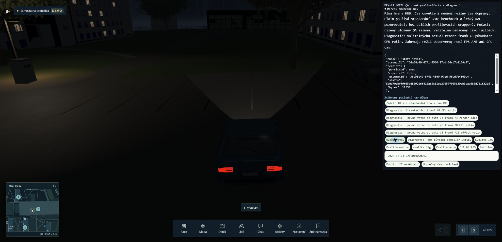

# Source15 · druhé diagnostické okno 24. 10. 2026

Runtime je neměnný source15 `d38b63a6ac6c4c252b6137a9c5c54d2fd6298a9d65363b289186c3070466b43c`. Tato změna publikuje nové default-off QA nástroje a jejich výsledky; není přijetím migrace, FPS ani změnou produkčního kódu. GTX1060, driver582.28, CSS2040×986, skutečná plná hra/HUD. Běhy nejsou finální proložená A/B série a nemají kontinuální teplotní/taktovou telemetrii. Profilované časy zahrnují observer/JIT/GC/scheduling a nejsou GPU execution time.

## Přesné nástroje a kontroly

Startup V20/helper38 `d028aac77c25b0ee350a3745a86ee8c6c95962213af4bc8d03f0b6768f6e2c91` navazuje na V19 a mění pouze přesný copied-test pack count36→38. V18/V19 sealy zůstaly beze změny. [V20 zdroje a testy](../../startup-stage-routines/corpus-compat-v20/sources/) a [RED/GREEN](../../startup-stage-routines/corpus-compat-v20/checks/).

Entry V19/helper39 `80419b9012d8f8c4a0ac5f23260e874fa7cb408f9d1b9ab9dc8ac5270c7c1dd1` je přesná dříve předaná kopie s novou Standard regresí. Jeho runtime se od V18 nemění. Původní V18 a review-fix-v19 zdroje/testy jsou v samostatném [entry adresáři](../../entry-effect-cost/).

| Corpus | PASS / FAIL / SKIP | Význam |
|---|---|---|
| startup-v20-corpus-1 | 472 /3 /0 | Launcher neměl --expose-gc;3 GC testy správně selhaly. |
| entry-v19-corpus-1 | 495 /3 /0 | Stejná chyba launcheru, zachovaný původní výstup. |
| startup-v20-corpus-2 | 475 /0 /0 | Celý helper corpus, správný GC flag, před/po helper SHA stejné. |
| entry-v19-corpus-2 | 498 /0 /0 | Celý helper corpus, správný GC flag, před/po helper SHA stejné. |

Každý adresář obsahuje skutečné TAP a verification.json s příkazem, vstupy a hashi. Ani tyto testy, ani dřívější CI cd4a95a1/2179PASS nejsou FPS důkaz. CI nespouští ignorované helper kopie; jejich corpus je doložen zvlášť.

## Skutečné výsledky

| Běh | Výsledek a omezení |
|---|---|
| startup-v20-high | Rejected: Low30.0337s/18etap; High cíl nebyl dosažen,0capturedframes, completefalse. |
| startup-v20-low | Resolved76.5800s/76etap; Low29.5461s (jen453.9ms rezerva), Medium25.7408s, High16.2389s, finalMedium5.0540s. Vybraná Low day-1-on etapa skončila po6skutečných renderech a splnila nový stage kontrakt. |
| entry-v19-effects/mp-startup | Resolved77.591s; první car profil skončil deadline bez accepted triggeru. |
| entry-v19-effects/mp-retry-startup | Resolved79.9278s; car retry také deadline bez accepted triggeru. Nejde o úspěšné zachycení vstupu. |
| entry-v19-effects/mp-final-startup | Rejected: Low30.5366s/18etap. Během startu proběhl root heartbeat CLI; confounder, nikoli čistý potvrzovací běh. |
| entry-v19-effects/guest-startup | Resolved71.4474s/76etap. Žádné MP připojení. |
| entry-v19-effects/guest-car-entry-effects | Skutečný accepted false→true vstup do auta;1progressed frame, pak retired, completedfalse. Před: actualLow1569×758/scaling1.3, requestedauto; automatická kvalita se adaptovala před arm. Nejde o fixní Medium ani MP A/B. |

Low skutečné render durations byly886.1/218.5/112.1/74.8/35.1/28.5ms. První render obsahoval PBR readiness235calls/655.4ms a Standard95calls/81.9ms. Inclusive řádky se překrývají; nelze je sčítat ani z nich určit vnitřní prepare/createEffect rozdělení. To zůstává chybějící startup měření.

Guest partial frame obsahuje PBR readiness333calls/53.4ms, z toho _prepareEffect47.9ms (selfSelected46.0ms), Standard134calls/30.1ms a engine.createEffect467calls/14.2ms. Tyto časy patří jinému scénáři a nelze je kauzálně přenést do startupu. Before pending0, po retirement pendingShaderValidation2 při stejném renderer4/generation1/errorCount0/phase ready. To silně podporuje hypotézu příliš přísného pending guardu, ale raw nezachytil failing predicate v okamžiku stopu. Nejde o hotovou diagnózu či opravu. Všechny vlastní routine/waiter hooks byly obnoveny na0.

Spawn marker má na nohou prioritu před autem. V Guest E nejprve našlo značku a následující E skutečně nastoupilo. Dřívější hypotéza, že předchozí MP relace zanechala obsazené auto, se nepotvrdila; serverové onLeave/park uklízí driverId. Původní neúspěšné receipty zůstaly zachované pod původními názvy.

## Původní záznamy, identita a úklid

`publication.json` váže94byteexact payloadů (včetně nových V20 sources/testů a pěti gzip originals), celkem6,436,047B; přenos ověřen po bajtech, credential-pattern matches0. Původní5source15 originals jsou explicitně vynechané a zůstaly neměnné. Nezávislý čtecí audit potvrdil94/94payloadů, všech5decompressedoriginals i nepřekrytí/původníhasheV17. Nový README a audit vznikly po seal a nejsou součástí těch94payloadů.

Po flatten mají všech5záznamů právě jeden závěrečný session-end/pagehide/bestEffortTailtrue a souvislébatchId. Čtyři mají přesně1ztracenou událost doloženou recording-gap/recordSize1:389d369d missingseq443 (end790),9117db94 missing464 (end1920),9c4b148d missing433 (end1067),ffae0bad missing582 (end772). e5e47d5e má souvisléseq0–245. Session-end dokládá zachycený konec, nikoli bezeztrátovou úplnost čtyřoriginals.

Samostatný guest-car-after stav už měl scaling1.65; compiler818→819 mezi samostatnými before/after proto nelze přiřadit entry ani konkrétnímu materiálu. Samotný rawentry before/after máLow1.3 a nový pendingValidation2. Runtime URL v uložených datech jsou jen127.0.0.1:4215 a avatars nejvýše1lokálníidentita; agregovaný resource souhrn není úplný networkcapture.

Každý run obsahuje identity.json, HTTP bundle kontrolu a raw receipty. Public assets zůstaly v přesném frozen snapshotu. Sidecar cleanup.json zachycuje jen preview, proto jeho apiOwnedOrStoppedfalse samo nepopisuje pozdější root úklid. Root v09:22UTC původním Ctrl-C zastavil preview37597 i API86953, obě exit1; původní UIleave, vlastní karta3920closed/viewportreset, skutečné listeners2568/4215/2599=0, Blender0. Všech6rezervovanýchzdrojů uvolněno před explicitně prodlouženým hard end09:25 a CAD potvrdil převzetí. Soubory zůstávají root-owned. Další build/GPU/server vyžaduje nové předání.

