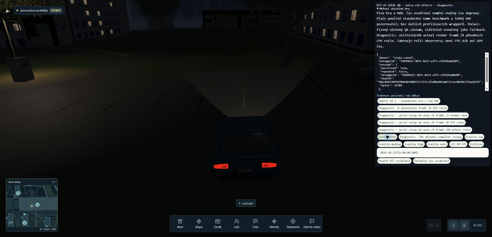
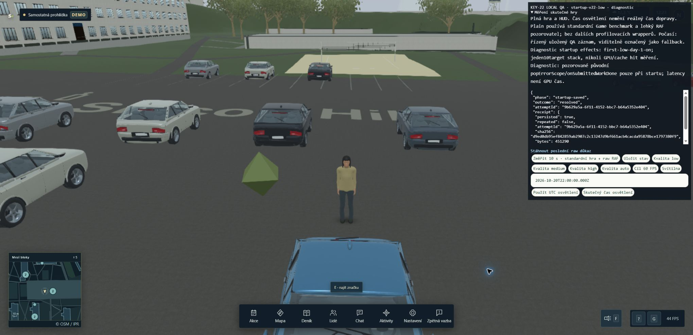

# WebGPU: úplný profil auta a startupu · 24. 10. 2026

Oba skutečné Guest běhy používají neměnný source15 `d38b63a6ac6c4c252b6137a9c5c54d2fd6298a9d65363b289186c3070466b43c`. Jde o diagnostiku plné hry s HUD na GTX 1060, driveru 582.28 a CSS viewportu 2040×986. Jediný idle vzorek P8/60 °C není kontinuální telemetrie. Běhy nejsou opakované FPS A/B, multiplayerová přejímka ani důkaz optimalizace. Produktový kód se v tomto kroku nemění.

## Ověření nástrojů

Entry V21/helper42 `9a594e60…` dovoluje po přijetí vstupu sledovat legitimní pending práci, přitom zachovává přísnou identitu, chyby a lifecycle. Přidává bounded svědectví o příčině ukončení a pending před/po snímku. Startup V22/helper41 `a6294c4b…` měří původní vybranou etapu společným stackem deseti rutin. Oba mají samostatné formáty, výchozí vypnutí a nezměněné historické nástroje.

Celá corpora prošla **539/539** a **512/512**, bez selhání či přeskočení a bez změny helper SHA před/po. Oba immutable buildy prošly. Tři nezávislé vrstvy review našly dvě lokální opravy: uzavření vnořených limits před legacy validací a nedostatečný test izolace čítačů cizí scény. Opravy vznikly v nových kopiích; následná tři review vrátila `[]`. Původní RED, GC a mutation důkazy zůstaly zachované v sousedních helper evidence adresářích. Exact repository CI `bad236f0` má samostatně 2179 PASS, build a integraci; ignorované helpery ověřují jejich vlastní corpora.

## Auto: dokončených osm snímků

[Entry receipt](entry-v21-effects/guest-car-entry-effects.json) má SHA256 `902f944f320e99bb46a870fe1a2abcf969251e07c7da6cdc55d930b99c72daea`, 67 482 B. Skutečný accepted foot→vehicle, Scene frames 2646–2653 a finální frame ID 2654. Pevné **Medium/scaling 1**, CSS i interně **2040×986**, osvětlení 23. 10. 2026 22:00 UTC, Guest/network false. Před přijetím i na zaznamenaných hranicích pending/error 0; terminal pending 0, firstFailure null a zbývající routine/waiter hooks 0.

| První main render | Calls | Inclusive ms | SelfSelected ms |
|---|---:|---:|---:|
| PBR readiness | 364 | 57,2 | 5,5 |
| PBR `_prepareEffect` | 364 | 51,7 | 48,0 |
| Standard readiness | 137 | 18,8 | 18,2 |
| `engine.createEffect` | 501 | 4,3 | 4,3 |

Inclusive řádky se překrývají. PBR prepare residual obsahuje `_prepareDefines`, fallbacky, ABI, plugin dispatch a serializer; 48 ms není samostatné měření `toString`. Navíc existuje jeden RTT PBR prepare/createEffect, přibližně 0,2/0 ms. První main PBR prepare má nullReturns 0, druhý 362 a od třetího všech 364. Pinovaný kód vrací null při čisté defines větvi, což dokládá hromadný dirty průchod při prvním snímku. Neprokazuje jednotlivé engine cache hity.

Nezávislý audit našel v původním recorderu přímou časovou korelaci: accepted trigger 149185,9 ms leží uvnitř CPU spanu začínajícího 149171,2 ms. Event seq496/**previousFrame** obsahuje CPU **198,9 ms** a render **184,2 ms**; doručovací interval je **205,2 ms**. Jeho currentCpuMs 61,3 a render 58,1 patří až následujícímu framu. Recorder nemá native frame ID; korelace je časová, s rozdílem zaokrouhlení timeOrigin 0,1 ms. Zásek tedy přetrvává; žádný nový FPS přínos se netvrdí.

Předchozí actual V19 byl auto/Low/scaling 1.3 a skončil po jednom framu. Není s tímto pevným Medium srovnatelným A/B. Regrese pro legitimní pending cestu je doložená CPU reproduktorem; konkrétní selhaný predicate původního V19 raw zachycen nebyl.

## Startup: dokončená Low etapa

[Startup receipt](startup-v22-low/guest-startup.json) má SHA256 `d9ed0db95ef842859ab2907c2c13247d9bf661acb4cacda95878bce1797380f9`, 451 290 B. Celá příprava **71,212 s / 76 etap**: Low 25,2617 s, Medium 24,4063 s, High 16,0990 s a finální Medium 5,4449 s. Vybraná etapa Low `day-1-on` obsahuje sedm po sobě jdoucích renderů 175–181; stage-end complete odpovídá novému startup kontraktu. Tato etapa měla jeden apply, sedm renderů a **nula restartů**.

| První main render | Calls | Inclusive ms | SelfSelected ms |
|---|---:|---:|---:|
| PBR readiness | 235 | 579,8 | 3,9 |
| PBR `_prepareEffect` | 235 | 575,9 | 45,8 |
| Standard readiness | 94 | 108,7 | 12,9 |
| `engine.createEffect` | 329 | 625,9 | 625,9 |

Celý první render trvá **814,9 ms**. Souhrnný API span 329 engine volání tedy dominuje tomuto renderu. Neznáme jejich skutečné cache větve ani distribuci jednotlivých časů. Následující engine calls jsou 52/0/0/0/0/52, přibližně 1,0/0/0/0/0/0,5 ms. Posledních 52 volání **není důkaz stage reapply**. Nula restartů tento dřívější pracovní odhad vyvrací.

Původní scope record226 trvá 48066,6→49056,2 ms a fence227 48066,6→49061,0 ms. Téměř úplně se překrývají a nesčítají se. Po renderu je zaznamenáno 105 pending operací: preparation45 a validation60. Jde o completion latency a synchronní CPU wall spans včetně observer/JIT/GC/scheduling, nikoli GPU execution nebo vlastnictví jednotlivého shaderu. Startupový náklad nelze odvodit z rychlých 4,3 ms engine API při vstupu do auta.

## Úplnost, reprodukce a úklid

`publication.json` váže 29 byteexact payloadů / 2 502 492 B; SHA256 `9da659aa01c5ec1d1e250b8b3ea75f5b8559d143380fd48bd2b80be66365190f`. Nezávisle ověřeno, credential patterns 0. Dva gzip originals se po rozbalení shodují s původními JSONL a nepřekrývají předchozích deset záznamů. Tento README a následný audit vznikají mimo těchto 29 sealed payloadů.

- Entry original `33e8c119…`: seq0–618, chybí370 s doloženým recordSize1; game-dispose přítomen, **pagehide/session-end chybí**. Poslední zachycená událost je longtask. Není vydáván za uzavřený či bezeztrátový záznam.
- Startup original `ddb17a09…`: chybí400/recordSize1; končí session-end465/pagehide/bestEffortTail true. Není bezeztrátový. BatchId jsou v obou souvislá.

Autoritativní samostatné receipty obou profilů jsou kompletní podle jejich vlastních kontraktů. Original completeness se tím nedoplňuje. Uložená identita je jen lokální Guest a pozorované URL pouze127.0.0.1:4215; souhrny nejsou úplný network capture.

Preflight ověřil všech 8588 source/test/asset souborů; původní source15 i starší helper/build sealy zůstaly neměnné. Build identity, helper SHA, source ID, před/po stavy, skutečné logy a screenshoty jsou přiložené. V tomto okně nebyla samostatně provedena celá lokální repository test/build/integration sada. Běžel celý helper corpus a jeho skutečné buildy, spolu s již samostatně doloženým remote CI checkpointem.

Pevné okno skončilo skutečným STOP/release v10:24 UTC, před hard end10:25. Own entry preview44752 a startup preview86397/API30681 skončily původním Ctrl-C; hry opuštěné UI, vlastní karty zavřené, viewport vrácen, ownGameTabs0, listeners2568/4215/2599=0 a Blender0. CAD převzetí potvrdil. Další GPU/build/Blender/server práci nyní vlastní B1+B6; KEY22 zůstává otevřený, main/default ani finální FPS matice nepřijaté.

