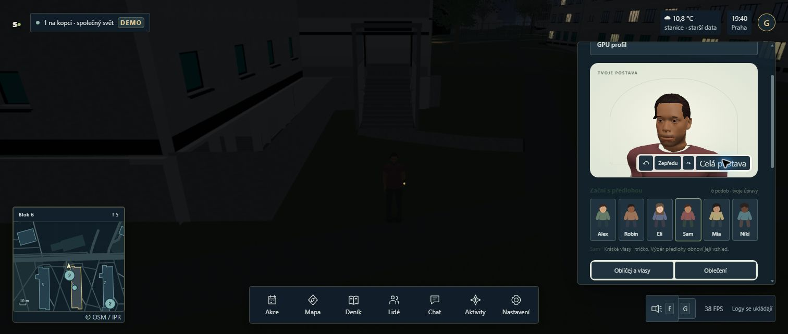

# KEY-39 / KEY-31: stabilní native-v16 a combined-v5

17.10.2026. Opravy jsou integrovány do main; celá WebGPU migrace ani výkonová přejímka tím nejsou dokončené. Výchozí renderer se nemění.

## Implementace a integrace

Native zdroj: `8363c7603028a5a11b2f3d54f7a702c34ccfb608`. Oprava obnovuje skutečný base efekt před shadow pass a konzervativně ověřuje světelné sloty. RenderHealth zachytí terminální chybu celého enginového snímku; Game/UI zruší ready, input a další GPU mutace. Ruční startup/preview už po vadném snímku nevolají endFrame a zachovají původní chybu. Omezený inventář nepoužitých shaderových konstant je pouze lokální opt-in; WGSL, cache ani běžný renderer se tím nemění.

Pět samostatných main commitů: inventář `4a8e343de65a3ca386a01130999a4450535f2958`; health `37a4137eec990f0308050308e7375339952fe8fd`; stíny `36734e96f00df395dfbf7520effdfa7af03b34b2`; ruční snímky `6d42c8f588b0a8f3ad6fae5150963210b85fe6d6`; Game/UI `a2acbed882412138713780f530a260c34253411d`. Čisté native bloby jsou commitnuté; C5 overlay zachovává30 cizích změn pouze ve working tree. [Kontrola main](main-verification.json) potvrzuje čistý index, shodný committed runtime a549 fyzických zdrojů shodných s C5. Receipty jednotlivých jednotek jsou vedle tohoto souboru.

## Úplné ověření

| Snapshot | Testy | Typy/build | Izolovaná integrace |
|---|---:|---|---|
| Native-v16 `f1d6c2bdd58f6c73fbaeec1f0b6326a4bda9e4c04449bc112cdd05ad609f4397` |1260/1260|PASS|PASS|
| Combined-v5 `c4e22edd3b691fce2827b5132ccbc09ec404a0aa6fd1338925ffddbe8a5be6f5` |1320/1320|PASS|PASS|

[Validační záznam](validation.json), oba úplné source manifesty, složení C5 a šest pipeline logů jsou uložené zde. Oba buildy nesou vlastní snapshot tag. C5 merge preview má68/68 cílených testů aTS3002/0; Game/UI86/86 aTS3513/0. Nezávislé sémantické review i review integračního helperu: findings[]. Žádný jejich výsledek nenahrazuje GPU přejímku.

## Skutečný Edge průchod

Native krátký smoke: [souhrn](native-smoke-summary.json), [raw](native-smoke-session.jsonl).499 souvislýchrecords,170framewindows,0faults. Low startup39.5376s, light preparation19.4458s; změny medium/high/low a night/golden/real se svítilnou. Poslední explicitně zaměřené W doložilo pohyb. Část startupu překrývaly lehké CPU kontroly, proto nejde o A/B.

Combined session `4ecc6280-d257-4858-ada1-3ab856ce4691`: [souhrn s akcemi a omezeními](combined-summary.json), [neměnný JSONL prefix](combined-session-prefix.jsonl).1559 souvislýchrecords bez mezer,0 render/JS/asset faults. Jedna skutečná multi relace Alex; aktivní/unfrozen Edge1512×642, NVIDIA Pascal, bez profileEnvironment. Low startup35.3513s je popis této relace, ne srovnatelný přínos vůči WebGL.

Doložena skutečná chůze od parkoviště kolemB7 a vegetace, přes severní vstupní schody a portál do recepceB6:0 a zpět bez skoku. V B6 F-on, medium→high→low, day→night→golden→real; následně renderer ready/errorCount0. Game běžel od ready do dispose9min11,3s; poslední snímek končí41,5ms předdispose. Deset zavření a otevření editoru zachovalo renderer3; všechny [UI cykly](combined-editor-cycles.json) mají dostupné ovládání. Změna Sam/detail tváře se zobrazila v preview i ve světě; před ukončením vrácenAlex.

## Omezení a další práce

- Delší startup a vícesekundové post-ready záseky při změnách kvality/světla přetrvávají (C5 seq849:8001,2ms, seq1098:7074,9ms, seq907:6563,5ms; předchozí/aktuální CPU72,2/53ms,39,5/79,2ms a35,2/44,7ms). KEY-31 zůstává otevřené. Naměřené JS CPU nevysvětluje celé mezery, konkrétní GPU/driver příčina není prokázaná. První frame-hitch začíná před ready a není herní zásek.
- Není ověřená celá B6 trasa, vyšší patra/obě schodiště, původní přesné místo pádu, vzdálené avatarLOD, tři skutečné relace ani úmyslný GPU fault/restart. Reload se za fault test nepovažuje.
- Neproběhly tři proložené A/B páry ani finální FPS/p95/p99 přijetí. KEY-33/34/39 a migrační cíl zůstávají otevřené. Žádný přechod na webgpu-fast ani default flip.
- [Zachování historických hraných zdrojů](preservation.json):8418historických a8398hraných vstupů plus5servedfiles shodných. Manifest nehashuje celé node_modules, proto se netvrdí jejich úplná byteidentita.

Pracovní služby: immutable combined-v5 na4193/API2588. Procesní identita je lokálně v `.cache/webgpu-migration/runs/combined-v5/runtime.json`; hrané4192/4188 se nepřepisují.
