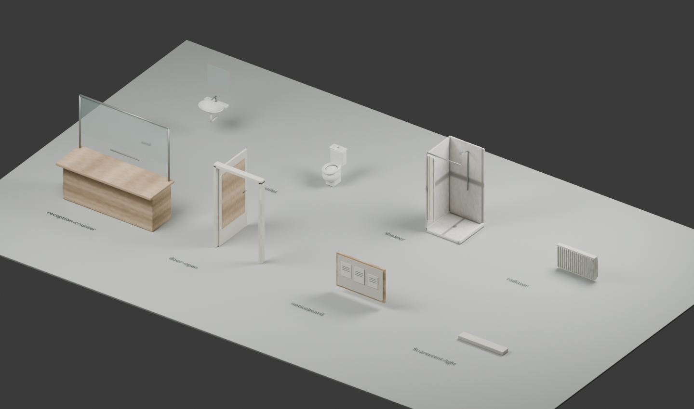

# B6: interiérový balíček podle doložené typologie

Aktualizace 11. 10. 2026: dvě schodišťová jádra podle schématu B6 nahradila původní přímou rampu v chodbě. Nové materiály schodů a zábradlí vycházejí z uživatelem dodaného snímku výslovně označeného **BLOK 3**. Podrobnosti, nejistoty a nové testy jsou v [stair-photo-reconstruction.md](stair-photo-reconstruction.md). Balíček obsahuje také Blender GLB modely sociálního vybavení, recepčního okénka, dveří a technických detailů, materiály chodeb/pokojů, tabulky dveří, společné kolize a podlažní správu vykreslování. Aktuální inventář modelu je v [inventory.json](inventory.json); původní testy/modelování jsou v [tests.log](tests.log) a [blender-build.log](blender-build.log).

## Co bylo přímo prohlédnuté před modelováním

| Předloha | Viditelný podklad a použití | Co nedokládá |
|---|---|---|
| [Wiki B6: plán 2023](../../references/media/blok-6-plan-2023.jpg) | Dvě řady místností, chodba, dvě schodišťové sekce, vrátnicový výstupek a mezipatrové prostory. Umístění společných funkcí doplňuje [wiki B6](https://wiki.sh.cvut.cz/kolej/bloky/blok_6). | Plán nemá kóty ani severku; vzhled současného interiéru z něj nelze získat. |
| [ČVUT: pokoj, 16. 11. 2016](https://media.cvut.cz/sites/media/files/content/photos/45cbe750-1f12-495b-98d7-47a7d17c33f2/1a0d26c4-1e5a-40f7-86b1-8399f384e3f6.jpg) | Dřevěné postele, stoly u oken, skříně, stropní difuzor a hnědobéžový vinyl. Celá patnáctisnímková galerie byla vizuálně prohlédnutá. | Fotografie nepotvrzuje B6 ani stav 2026. Nábytek představuje archivní Strahov typologii. |
| [ČVUT: archivní WC, 16. 11. 2016](https://media.cvut.cz/sites/media/files/content/photos/45cbe750-1f12-495b-98d7-47a7d17c33f2/1ffe42dd-d3d4-4a11-9dda-4fdc6aa19ecb.jpg) | Stojící keramické WC s nádržkou, světlé starší obklady a dlažba. Model má vlastní dutý lem a objem mísy. | Nejde o potvrzenou současnou toaletu B6; dekorativní fotografická bordura nebyla kopírovaná. |
| [ČVUT: starší chodba při prohlídce B3, 20. 6. 2024](https://media.cvut.cz/sites/media/files/content/photos/b310bc4d-e08f-4ffe-a0ba-2e29451de103/fd1161ca-2fd9-418d-88cf-1103cfa7af71.jpg) | Krémové dveře, šedé rámy, pásovaná dvoubarevná dlažba, nízké stropní nosníky a liniové osvětlení. Další pohled [chodby](https://media.cvut.cz/sites/media/files/content/photos/b310bc4d-e08f-4ffe-a0ba-2e29451de103/549dadec-2a2e-49e9-a7f7-c98b95e5ccf6.jpg). | Jde o starší B3 v galerii otevření B4, ne o fotografii B6. Barvy i rozměry B6 zůstávají odhadem. |
| [ČVUT: nové sociální zařízení B4, 20. 6. 2024](https://media.cvut.cz/sites/media/files/content/photos/1a9fbb77-c02d-4a25-97c7-4cdcb7049f52/13802908-16c1-4d11-8c1f-e05a12538c12.jpg) | Prohlédnuté pro porovnání formy umyvadel, sprch, rámů a instalací. | Nové šedé renovované obklady B4 nebyly označené za B6; naše typové sociálky používají střídmou starší krémovou variantu. |

Ve veřejných prohlédnutých zdrojích nebyla nalezena identifikovaná fotografie **interiéru recepce B6**. Recepční pult s okénkem a nástěnka jsou vlastní konzervativní odhad podle doložené funkce vrátnice; confidence je nízká. Není použitá fotografie jiné recepce jako údajně přesná B6. Fotografie byly prohlíženy dočasně v paměti; jejich pixely ani kontaktové přehledy nejsou součástí hry či archivu balíčku.

## Dispozice, okna a přístupnost

Půdorys je kalibrovaný na současný herní obal 16 × 70 m s představenou vrátnicí. Opakovaný modul je `70/22 ≈ 3,18 m`, sdílený s fotograficky odvozenou fasádou. V modelu vzniká **35 typových ložnic a dvě společné sociální místnosti na obytné úrovni**; celkem 210 ložnic a 12 sociálních místností. Tři západní ilustrační bay pozice na každé úrovni byly uvolněny pro druhé schodiště skutečně zakreslené v plánu. **Jde o modelový počet, nikoli ověřený inventář B6.** Čísla `TYP ...` na dveřích jsou ilustrační a nespojují pokoje se skutečnými obyvateli.

Boční stěny mají skutečné otvory: podokenní pás, nadpraží a pilíře, mezi nimi tenký kolider `kind="glass"`. Není za nimi neprůhledná náhrada celé stěny. Transparentní sklo vykresluje pouze fasádový systém. Střed okna vychází z globálního severního počátku `z=-90+(i+0,5)*70/22`, výška 1,5 m a parapet 0,85 m nad podlahou; jsou to kalibrované hodnoty s nejistotou.

Vstup je na **severní krátké straně vrátnicového výstupku**, s příchodem směrem na jih. Určení vychází z přímo prohlédnutého [panoramatu B6 ze září 2025](https://www.google.com/maps/@?api=1&map_action=pano&pano=gWCshoWQgiJdy1QWcqe1eQ&heading=178.82123&pitch=20), šipky 1.NP VRÁTNICE v plánu B6 a orientace doložené oficiálním plánem ELSA. Dřívější západní vstup byl chybnou interpretací; nyní je na této straně souvislá stěna. Souřadnice dveří `(-4,85; -77,15)` a severní stěny lobby `z=-77,1` jsou kalibrace na mapový podklad s přibližně dvoumetrovou nejistotou, nikoli zaměření.

`foundationOffset=1,8 m` a dvanáct vstupních schodů po 0,15 m jsou **modelový odhad s nízkou důvěrou**: [ELSA ČVUT](https://www.elsa.cvut.cz/bezbarierove-cvut/pristupnost-objektu/objekt/?o=81) uvádí pro bloky 2–7 zpravidla dvanáct krytých schodů. Výšku stupně ani skutečnou výšku prahu B6 tento zdroj nedokládá. Všechna data místností, skel a rekvizit jsou relativní k nule podlahy; root přičítá nadmořskou základnu a tento offset jednou. Vnější schody mají relativní výšku −1,8..0 a souvislou podestu až k lobby. `b6EntranceHeight` vrací světovou výšku povrchu včetně zadané základny; nepřičítat offset podruhé. Podrobná oprava, zdroje a testy jsou v [north-entry-correction.md](north-entry-correction.md).

Trasa vrátnice → severní podlažní podesta → dvě protilehlá ramena → další patro je souvisle průchozí. Severní jádro leží v západním servisním pásu `x=0,25..5,75; z=-78,6..-71,1`, jižní v `z=-38,1..-30,6`. Hlavní chodba `x=6..10` je nyní rovná po celé délce. Schéma dokládá dvě jádra a mezipatra; konkrétní metrické rozměry a směry ramen zůstávají přiznaným odhadem. Každá úroveň používá dva lety po deseti stupních, souvislou šikmou spodní desku a společnou mezipodestu. Černé svislé balustry, dřevěná madla a pásovaná dlažba jsou typologií B3, nikoli prohlášením o současném B6.

## API a integrace

- `shared/b6-interior.ts`: `B6_REALITY_BOXES` (též předávací alias `B6_REALTITY_BOXES`), `B6_ROOM_AREAS`, `B6_LAYOUT`, `b6EntranceHeight`.
- `shared/b6-stairs.ts`: `B6_STAIR_CORES`, `B6_STAIR_MESHES`, `B6_STAIR_BOXES`, `b6StairRoute`; stejné lokální metry pro renderer a fyziku.
- `shared/b6-stair-materials.ts`: společné PBR parametry, fyzická měřítka UV a reprodukovatelné vlastní pixelové vzory.
- `shared/b6-props.ts`: `B6_PROP_PLACEMENTS`, `B6_PROP_COLLISIONS`, `B6_ASSET_MANIFEST`. Obálky kolizí používají přesně stejné transformace jako GLB instance.
- `client/b6-reality.ts`: `await loadB6Reality(scene, {foundationY})`; controller `update({player,quality,floor?})`, `dispose()`, `stats`.

Hlavní integrace musí nahradit staré B6 boxy novým exportem, přidat kolize rekvizit a odstavit původní pokojový rozptyl z `shared/environment.ts` i původní neprůhledné vykreslení B6. Exteriérové fasády a jejich jediná sada skel zůstávají v architektonickém rendereru. `foundationY` znamená celkovou herní výšku podlahy B6.

Geometrie konstrukcí se skládá přímo do batchů podle patra a materiálu, nevznikají tisíce dočasných boxových meshů. Rekvizity sdílejí jednou načtené zdroje, neaktivní podlaží a vzdálené místnosti se odpojují ze `scene.meshes`. Osvětlení používá nejvýše jedno místní bodové světlo, zapnuté pouze uvnitř. Textové štítky sdílejí mipmapovaný atlas a pevnou světovou geometrii.

## Ověření a licence

`pnpm exec tsx --test tests/b6-reality.test.ts` kontroluje modul a nejistotu, analytické výšky schodů, souvislou chůzi od severního venkovního spawnu přes dvanáct schodů a všechny kolize rekvizit až na první patro, uzavření starého západního vstupu, fyzické zasklení bez neprůhledné záslepky, UV výřezy dveřních tabulek, existence GLB/.blend, culling i úklid rendereru. NullEngine části neprokazují GPU obraz nebo FPS; hlavní integrace potřebuje skutečný browser průchod a nový produkční benchmark.

Reprodukce modelů a studiového náhledu:

`"C:/Program Files/Blender Foundation/Blender 5.2/blender.exe" --background --python scripts/create-b6-reality.py`

Deset vlastních assetů dohromady obsahuje 5 348 trojúhelníků a přibližně 446 kB GLB. Čtyři PNG textury a bitmapové atlasové popisky jsou autorské procedurální zdroje. Původní fotografie zůstávají odkazy. Plán B6 má původ a deklaraci CC BY-SA v [původní evidenci](../../references/LICENSES.md). Přesnost dnešní B6 recepce, pokojového inventáře, sanitárních dispozic a výškových kót není doložená.
