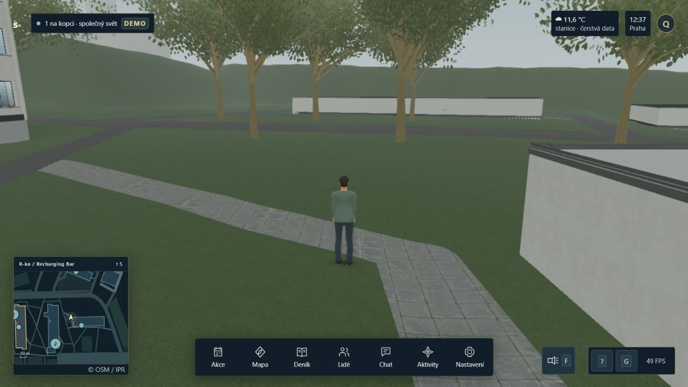

# Věrohodnější stromy tráva a asfalt

Analýza k 12. říjnu 2026 doporučuje změnit především **stavbu stromových modelů a sladění travního podkladu se stébly**. Babylon už umí potřebné materiály, instancování i vítr. Pro tento projekt dává smysl připravovat kvalitnější modely v Blenderu nebo SpeedTree a do hry dodávat odvozené úsporné assety. Přínos migrace celého enginu se z nalezených problémů neprokazuje.

Současné stromy nejsou jednoduché levné modely: nejdetailnější listnáč obsahuje tisíce listových ploch, ale jejich rozmístění málo vystihuje skutečné větvení. Největší příležitostí je lepší silueta a uspořádání listů při podobném nebo nižším nákladu. Lepší textura země by pomohla také, pokud odpovídá velikosti, hustotě a barvě prostorové trávy.

## Co dnes skutečně běží

| Vrstva | Současná implementace | Důsledek pro další práci |
| --- | --- | --- |
| Stromy | Blender Python vytváří samostatnou geometrii každého ID; tři úrovně detailu, sdílené PBR materiály, streamování blízkých modelů. | Připravit lepší geometrii mimo runtime je možné již v současné architektuře. |
| Listí | Zahnuté obdélníkové plochy, celý atlas LeafSet001/019 na každé ploše, alpha test 0,5. | Ořezání a skládání větviček může zlepšit vzhled i využití vykreslované plochy. |
| Prostorová tráva | Fotografické listy odvozené z Poly Haven Grass Medium 01; vlastní krátká geometrie, tři sdílené instance dávky. | Historický popis 16 procedurálních stébel v nadřazeném README není popisem současné produkční trávy. |
| Travní zem | ambientCG Grass001, barva + NormalGL + drsnost, opakování 1,4 m. | Jde o procedurální travní materiál, odlišný od fotografické předlohy stébel. |
| Asfalt | ambientCG Asphalt033, stejné tři kanály, opakování 2,5 m. | Materiál už má jemnou strukturu. Je třeba prověřit čitelnost, variaci a návaznosti. |

Vstupy a runtime: [generátor stromů](../../../scripts/tree-pack-blender.py), [stromový controller](../../../client/vegetation.ts), [vzhled stromů](../../../client/tree-appearance.ts), [fotografická tráva](../../../client/photographic-grass.ts), [povrchové materiály](../../../client/surface-pack.ts), [výtvarná receptura](../../../client/cinematic-art.ts). [Statický audit stromů](tree-audit.json) a [audit země](ground-audit.json) obsahují otisky konkrétních souborů a reprodukovatelné výpočty.

## Proč stromy působí uměle

Generátor vytváří listnatý kmen ze čtyř prstenců s lineárním zúžením, vždy 19 hlavních větví a nejvýše pět jemných větví na každé. Trubky se protínají bez modelovaného plynulého rozvětvení. Chybí přesvědčivý přechod do kořenů a různorodost anatomie větví. Náhodný seed mění detaily, ale zachovává podobný stavební vzorec.

Nejdetailnější koruna má 2 200–4 800 zahnutých karet, každou ze čtyř trojúhelníků. Přibližně 80 % karet se rozptyluje do obecného korunového objemu místo návaznosti na konce větviček. Každá používá celý atlas se šesti oddělenými listy ve mřížce. Výsledkem je rovnoměrné tečkování a podobně zaoblené koruny. To je výtvarná interpretace generátoru a níže uvedených snímků, nikoli měření botanické věrnosti.



Archivovaný produkční snímek D2 z 12. 10. 2026 ukazuje světlé tyčovité kmeny a opakující se vějířovité větvení. [Jeho původní záznam](../../verification-evidence/campus-depth-20261012-d2/production-smoke.json) patří danému checkpointu; nejde o obrázek nově vytvořeného modelu. Číslo FPS v obrázku se nepoužívá jako benchmark této analýzy.

Tři konkrétní technické problémy:

1. **Málo využitá plocha listových karet.** Při alpha cutoff 0,5 pokrývá viditelná část atlasu LeafSet001 pouze 19,4797 % a LeafSet019 22,8044 %. Zbytek plochy se zahazuje. Jde o podíl texelů zdrojové masky, nikoli změřený obrazový overdraw; překryv korun a stínové průchody je třeba profilovat zvlášť.
2. **S přepnutím detailu rostou listy.** Šířka listnaté karty 0,68–0,94 m se násobí 1,9× u prostředního a 3,5× u vzdáleného modelu. Vzdálená karta tak měří 2,38–3,29 m a nese stále stejných šest listů. LOD mění čitelné měřítko motivu. Přepnutí je tvrdé a řídí se vzdáleností hráče, nikoli velikostí koruny na obrazovce.
3. **Velký objem textur už při startu.** `far.glb` má 76 500 488 B, z toho vložené textury 67 850 872 B. Všech devět map má skutečně 2048 × 2048 px. Dvě listové normal mapy jsou 16bit RGB PNG o 18,34 a 19,49 MB. Vyšší rozlišení není první chybějící vlastnost.

Současný runtime již míchá původní normálu s normálou objemu koruny v poměru 28:72 a přidává slabé prosvítání listů 0,12. Dvojstranné vykreslení je zapnuté, automatické obracení normál rubu vypnuté. Při nové stavbě korun se musí tato aproximace znovu posoudit: normála celého elipsoidu nemusí vhodně osvětlovat jednotlivé výrazné větvičkové shluky. Další globální tónování nemůže nahradit strukturu modelu.

### Statický rozpočet stromů

| Všech 109 umístěných stromů ve stejné úrovni | Trojúhelníky |
| --- | ---: |
| Nejvyšší detail | 1 950 532 |
| Prostřední detail | 648 690 |
| Vzdálený detail | 254 090 |

Součty nejsou nákladem jednoho snímku. Hra kombinuje různé úrovně a odřezává neviditelné objekty. Stromy mají vlastní geometrie a obvykle dva meshe na ID, sdílejí materiály; nejde o instancování celých stromů. Při viditelnosti všech by šlo o 217 aktivních meshů před stínovými průchody. Bootstrap a detailní geometrie se načítají odděleně.

Devět RGBA8 textur 2048² s plnými mipmapami by teoreticky zabralo přibližně 192 MiB. Je to výpočet za uvedeného předpokladu, nikoli měření skutečných formátů a obsazené GPU paměti. Velikost PNG/JPEG souboru a paměť po dekódování jsou různé veličiny.

## Jak stromy modelovat lépe

Základem má být dobře čitelná kostra kmene a větví, na ni navázané olistěné větvičky a nepravidelné skupiny těchto větviček. Koruna potřebuje větší hmoty, menší shluky a přirozené mezery, nikoli stejnoměrnou hustotu. Pozemní fotografie pomohou s výškou nasazení koruny, štíhlostí kmene, charakterem kůry a větvením. Letecký podklad zůstává vodítkem pro polohu a obrys.

Praktický postup pro jeden listnatý prototyp:

1. Vybrat konkrétní zdrojové ID a referenci. V Blenderu ručně doladit kmen, hlavní větve, přechody rozvětvení a kořenový náběh. Druh uvést jen tam, kde je ověřený.
2. Vytvořit několik malých olistěných větviček. Nejbližší obrys může mít skutečné jednotlivé listy; vnitřní a vzdálenější části mohou používat ořezané, mírně prohnuté plochy s upečeným atlasem větvičky. Výřez má těsně obepínat obsah, nesmí být jen velký průhledný obdélník.
3. Větvičky rozmístit podle struktury stromu a upravit jejich natočení, hustotu a mezery. Sdílené díly šetří geometrii, ale finální silueta respektuje konkrétní korunu. Samostatné ID nemusí znamenat samostatnou kopii každého listu v paměti.
4. Zkontrolovat rub listů, světlo procházející listem, normály shluků, kůru v metrickém měřítku a kontakt s půdou. Stín koruny je součást výsledku.
5. Vyrobit LOD zachovávající siluetu a pokrytí. Ve střední vzdálenosti ubírat neviditelné větvičky a péct celé shluky při zachování zdánlivé velikosti listů. Nejvzdálenější model porovnat s víceúhlovým impostorem, tedy několika pohledy stromu na jednoduché geometrii. Impostor musí zvládnout natočení kamery, světlo a stíny; není automatickou náhradou pro všechny pohledy.

Alpha maska je pro takové listy běžná volba; specifikace glTF ji uvádí právě pro vegetaci. [glTF materiály](https://registry.khronos.org/glTF/specs/2.0/glTF-2.0.html) Úprava normál a průsvitnost mají oporu v [primárním popisu vykreslování SpeedTree](https://developer.nvidia.com/gpugems/gpugems3/part-i-geometry/chapter-4-next-generation-speedtree-rendering). Konkrétní vzhled a náklad navržených shluků jsou stále k ověření ve hře.

## Možnosti mimo současný stack

| Cesta | Přínos | Cena práce a integrace | Vhodnost pro projekt |
| --- | --- | --- | --- |
| Blender a ručně dotažené procedurální větvení | Úplná kontrola nad modelem, atlasem, LOD a editovatelným zdrojem. | Největší podíl vlastní výtvarné práce; samotný generátor nezaručuje kvalitu. | Doporučený základ pro několik kvalitních předloh a individuální úpravy siluet. |
| SpeedTree 10 → FBX → Blender → GLB | Specializované modelování stromů, výřezy listů, atlasy a nástroje LOD. | Placený modeler, knihovna samostatně; vítr a speciální runtime data se musí převést a ověřit. | Silná volba pro rychlejší výtvarné iterace. Není nutné přejít na Unity. |
| Hotový kvalitní asset nebo sken → úpravy a zjednodušení | Rychlý přístup k věrohodným větvím, kůře a listovým atlasům. | Výběr vhodné předlohy, retopologie, redukce materiálů a kontrola licence. | Dobrý referenční prototyp; kvalita renderu sama nedokládá vhodnost pro web. |

[Blender Geometry Nodes](https://docs.blender.org/manual/en/latest/modeling/geometry_nodes/instances.html) podporují skládání sdílených částí při tvorbě. [Sapling](https://extensions.blender.org/add-ons/sapling-tree-gen/) je komunitní extension; lze ji použít jako kostru, ne jako hotovou výtvarnou odpověď. [Licence Blenderu](https://www.blender.org/about/license/) se nevnucuje vlastním vytvořeným obrázkům a modelům.

[Aktuální SpeedTree](https://unity.com/products/speedtree) výslovně podporuje jiné enginy než Unity a uvádí FBX, OBJ, USD a další exporty; běžný GLB zde uveden není. Nástroje pro LOD a vítr neznamenají, že se proprietární shader automaticky přenese přes FBX. Pro Babylon je rozumné převzít geometrii, atlas a váhy ohybu a použít vlastní jednoduchý větrný shader. Modeler, knihovna a runtime SDK jsou odlišné části nabídky.

Extrémní příklad nároků knihovny: [Poly Haven Pine Tree 01](https://polyhaven.com/a/pine_tree_01) uvádí 17 milionů trojúhelníků a dostupné LOD. Je to zdroj ke zpracování, ne doporučení vložit nejvyšší detail do této hry. Poly Haven publikuje assety pod [CC0](https://polyhaven.com/license). U nakupovaných modelů je nutné rozlišit distribuci hry a zveřejnění samostatného zdrojového assetu; například [Fab Standard](https://www.fab.com/eula?lang=en) druhou možnost omezuje.

Unreal lze použít jako vizuální referenci pro způsob stavby vegetace. Jeho doporučení nelze přenášet jako rozpočet pro WebGL: [Epic upozorňuje](https://dev.epicgames.com/documentation/unreal-engine/working-with-naniteenabled-content), že tradiční listové alpha karty mohou s Nanite vyjít hůře než bez něj. Přechod na jiný engine by zde znamenal širší změnu distribuce, rendereru a integrace hry, zatímco nalezené nedostatky modelů by zůstaly k vyřešení.

Přenos přes glTF není jen export tlačítkem. Je nutné zkontrolovat UV, normály, tangenty, alpha masku, měřítko a výsledný materiál. Procedurální Blender graf není runtime shader. Novější [KHR_materials_diffuse_transmission](https://github.com/KhronosGroup/glTF/blob/main/extensions/2.0/Khronos/KHR_materials_diffuse_transmission/README.md) podporuje prosvítání tenkých materiálů. Zde instalovaný Babylon 9.30.0 má odpovídající loader; jeho přítomnost není ověřením celého exportu z používané verze Blenderu ani jeho GPU nákladu. Současná hra už prosvítání konfiguruje přímo v PBR materiálu.

## Tráva a textura země

Produkční stébla vznikají z autorské geometrie 42 listů s fotografickými výřezy. Blízký trs má 168 trojúhelníků, prostřední 84, vzdálený 22. Rozpočty jsou 60/140/280 tisíc trojúhelníků a dosah 6/9/12 m pro low/medium/high, v okolí úsečky kamera–hráč. Tři dávky sdílejí geometrii i materiál. Mimo krátký dosah vytváří vzhled téměř výhradně textura terénu.

Zem používá [Grass001](https://ambientcg.com/view?id=Grass001), který poskytovatel označuje jako procedurální. Na lokálním zdroji jsou kromě trávy i výraznější jednotlivé spadané listy; pravidelně opakovaný motiv se liší od tří úzkých fotografických listových výřezů prostorového porostu. Současná makrovariace barvy už existuje. Pouhé přidání dalšího noise by tedy opakovalo použitý postup bez vyřešení nesouladu.

Pro výměnu bych vybíral **krátký sečený trávník se zeminou, drobnou plsťovou vrstvou a nenápadným opakováním**, při stejném ročním a vlhkostním charakteru jako stébla. Vhodné je pořídit vlastní kalibrovaný scan malé plochy Strahova a fotografie jejího okolí; referenční fotografie nejsou automaticky licencované textury. Pokud se použije obecná knihovna, musí být tento původ přiznaný.

Jako zkušební složka řidších míst stojí za porovnání [Poly Haven Sparse Grass](https://polyhaven.com/a/sparse_grass), autor Amal Kumar, 2 m, CC0. Obsahuje půdu a řídký porost; není to ověřená náhrada celé udržované louky. Materiál je vhodné vybrat podle pohledu na celou rovinu, nikoli podle pěkné náhledové koule. [Technické standardy Poly Haven](https://docs.polyhaven.com/en/technical-standards/textures) vyžadují zaznamenané fyzické rozměry a albedo s potlačeným osvětlením, což jsou užitečná kritéria i pro vlastní scan.

Priorita pro trávník:

1. Sladit typ, měřítko a světelnou odezvu půdního materiálu s prostorovými stébly; zkontrolovat vzhled po jejich zmizení do dálky.
2. Míchat malý počet souvisejících vrstev podle masky hustoty a doložených okrajů: hustší tráva, řidší tráva, půda. Stejná maska má řídit hustotu 3D porostu. Nenanáší se náhodné vyšlapané cesty.
3. Upravovat přechody k obrubám a chodníkům podle reference. Aktuální bezpečnostní výluka 0,35 m od komunikace spolu s kontrolou půdorysu trsu může vytvářet širší prázdný lem. Vizuální zjemnění nesmí pustit stébla do vozovky.
4. Teprve potom porovnat 1K a 2K mapy při pohledu ze stoje i těsně nad zemí. Více stébel není první krok.

Tráva se pohybuje větrem; stávající vzdálenostní oblast kolem hráče není simulace sešlapávání. Tato vlastnost by vyžadovala samostatný návrh, nikoli jen změnu textury. Zem reaguje na déšť, ale fotografická tráva nyní nedostává stejný vstup mokra, takže barevnou návaznost je potřeba zkontrolovat také za deště.

## Asfalt a hospodaření s texturami

Asphalt033 i Grass001 mají ve zdejší hře skutečně 1024 × 1024 px na kanál. Při daném měřítku vychází asfalt na 409,6 texelu/m, přibližně 2,44 mm/texel, tráva na 731,4 texelu/m, přibližně 1,37 mm/texel. Jsou to hustoty nejvyššího mip levelu; pohled do dálky, šikmý úhel a filtrování detail snižují.

Asfalt už dostává makrovariaci, změnu drsnosti při mokru i potlačení detailu do dálky. V pozorované celé hře však velké plochy působí velmi stejnoměrně. Nejprve bych porovnal charakter kameniva, drsnost a fyzickou velikost motivu za stejného osvětlení. [Poly Haven Asphalt 02](https://polyhaven.com/a/asphalt_02), Rob Tuytel, 3 m, CC0, je konkrétní kandidát do tohoto srovnání. Má charakter opotřebeného asfaltu; nelze jej automaticky prohlásit za shodu se Strahovem. Lokální opravy, spáry, špína a poškození patří jen tam, kde je dokládá referenční fotografie, s uvedeným datem a nejistotou.

Rozdělit je potřeba také mikrodetail kameniva a velkoplošné barevné/roughness změny. Jemný normálový detail může materiálu pomoci při nízkém slunci, ale nenahradí tvar obruby nebo skutečný výmol. Plošný displacement celého areálu není první hospodárný krok a při změně skutečné geometrie by vyžadoval shodu s kolizemi.

Pro runtime doporučuji uchovat původní assety beze změny a exportovat samostatné odvozené varianty:

- KTX2/Basis pro přenos a komprimované GPU formáty, s kontrolou listových hran a kvality normál. Babylon má [KTX2 podporu](https://doc.babylonjs.com/features/featuresDeepDive/materials/using/ktx2Compression/). UASTC je vhodný kandidát pro srovnání normál a alpha atlasů, ne příslib konkrétního zrychlení.
- Mipmapy zachovávající dostatečné pokrytí alpha masky; zkoušet proti světlé i tmavé obloze a za pohybu. Komprese nesmí korunu v dálce ztenčit nebo přidat světlé obrysy.
- Sdílené atlasy a vhodné balení datových kanálů. ORM textura musí mít správně zapojené kanály; albedo zůstává sRGB, normály a roughness lineární.
- Prostorově omezené skupiny instancí. [Babylon thin instances](https://doc.babylonjs.com/features/featuresDeepDive/mesh/copies/thinInstances) sdílejí rozhodnutí o viditelnosti celé dávky, takže jedna dávka přes celý areál může vykreslovat zbytečně mnoho objektů.

Přechod 1K→2K znamená čtyřnásobek texelů, 1K→4K šestnáctinásobek. Pro dvě současné tříkanálové 1K sady vychází za předpokladu RGBA8 a úplných mipmap přibližně 32 MiB, bez dalších kopií. Pět map travního atlasu 1024 × 512 by stejným výpočtem tvořilo přibližně 13,33 MiB. Skutečnou GPU paměť ani výkonnostní zisk toto neudává.

## Doporučené pořadí ověřitelného pilotu

| Krok | Konkrétní výsledek | Co rozhodne o přijetí |
| --- | --- | --- |
| Jeden listnatý strom | Lepší kostra, členěná koruna a ořezané větvičkové clustery pro existující ID. | Silueta, kořeny, kůra, rub listů a měřítko při 2/10/30/100 m. |
| Jeden jehličnan | Samostatná anatomie a shluky jehličí podle doložené siluety. | Objem z více směrů, mezery v koruně a návaznost na kmen. |
| Jeden úsek země | Sladěný trávník, prostorová tráva a navazující asfalt. | Stejný úsek s původním a novým materiálem, bez změny počasí a kamery. |
| Export a LOD | Úsporné odvozené textury, zachovaná koruna a plynulejší přechody. | Velikost downloadu, příprava assetů, překryv alpha ploch, stíny a pohyb kamery. |
| Integrace a cílený refaktoring | Sdílené materiály/díly, jasné vlastnictví zdrojů, uvolnění streamovaných LOD. | Jednotné polohy/rozměry s kolizemi, stabilní cache, žádné opakované alokace při ustáleném pohledu. |

Za rozumný první experiment považuji přesvědčivější strom při nejvýše současném geometrickém rozpočtu a výrazně menším bootstrapu. Tento relativní cíl ještě není důkaz optimálnosti. Testy proti identickým přeměřeným kopiím stromů se při zavádění sdílených dílů musí změnit podle nové specifikace, při zachování individuálních ID a doložených siluet.

Přijetí výkonu vyžaduje párové měření celé produkční hry s HUD, stejným světlem, počasím, kamerou a avatary. Zapsat hash zdrojů včetně testů, GPU, CSS i interní rozlišení, FPS, p95/p99, draw calls, stínové průchody a čas přípravy při prvním příchodu. Porovnat stejný počet skutečných relací, včetně scén s 30 a 100 účastníky podle integračního rozsahu. Měřit vždy jednu 3D scénu bez souběžného Blenderu. Na stabilním funkčním checkpointu spustit `pnpm test`, `pnpm build` a izolovaný `pnpm test:integration`.

## Provenience a rozsah tohoto ověření

Stromový katalog má 110 kandidátů, z nichž nynější mapové výluky připouštějí 109: 47 poloh OSM a 62 interpretovaných korun. Výsledkem je 107 listnatých, jeden holý a jeden jehličnatý strom. IPR ortofoto z 8. 6. 2024 a zelené body modelu z léta 2023 poskytují historické vodítko pro obrys, výšku a orientaci. Střed koruny není zaměřený kmen; uvedená nejistota je až 2,5 m. Botanický druh, přesné větvení a některé rozměry zůstávají odhadem. Podrobnosti a licence jsou v [dokumentaci stromového packu](../realistic-pack.md). Pozice a kolize nadále vycházejí ze sdílených dat.

Tato práce je audit a návrh, ne nová verze modelů. Byly prohlédnuty zdroje, původní mapy a archivované snímky, přepočteny rozměry, alpha pokrytí a statické náklady. Cílená existující regrese stromů prošla 13/13; příkaz a původ výsledku uvádí evidence. Hlavní agent navíc prošel běžící produkční hru na 4179 v samostatné prohlídce přes nádvoří a travnatý okraj u Klubu 007, 12. 10. 2026 přibližně 13:20–13:25 Europe/Prague. Pozoroval stejnoměrný travní podklad, málo členitý asfalt a schematické vzdálené kmeny. Živý vzhled nebyl zaměněn za benchmark ani za snímek všech rozpracovaných zdrojů.

Nebyla měněna hra ani původní assety. Plná sada, build a integrace se pro tento dokumentační audit nespouštěly; pracovní strom zároveň obsahoval jiné rozpracované úpravy osvětlení a počasí. Všechna nová doporučení proto potřebují vlastní vizuální a výkonové porovnání po realizaci. [Centrální záznam ověření](../../verification.md) rozlišuje tento audit od funkčních checkpointů.

Reprodukce statické evidence z kořene repozitáře:

```powershell
node --import tsx docs/vegetation/realism-audit-20261012/tree-audit.mjs
node docs/vegetation/realism-audit-20261012/ground-audit.mjs
```

Webové podklady byly ověřeny 12. 10. 2026. Primární dokumentace vysvětluje možnosti nástrojů a algoritmů; neprokazuje naměřený přínos v této hře.
