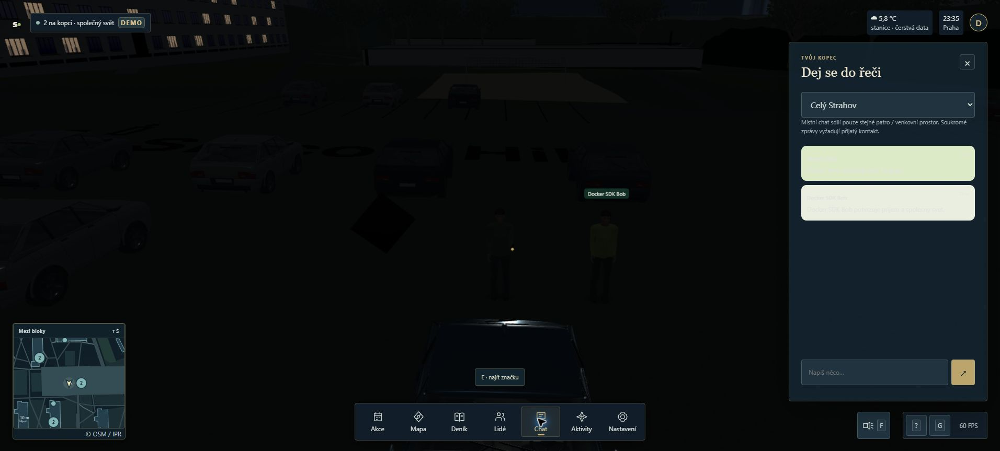

# KEY-45 — Docker přejímka, 19. 10. 2026

Jeden neprivilegovaný Node kontejner poskytuje sestavený web, API a jediný společný svět. Ověřený příkaz je `pnpm test:docker` (testovací port18082, unikátní Compose projekty). Produkční spuštění používá `docker compose up -d --build` a localhost8080.

## Výsledky

| Kontrola | Skutečný výsledek |
|---|---|
| Cílené runtime HTTP/config testy | 2/2 PASS; MIME, range, HEAD, ETag304, dotfiles/traversal403, chybějící asset404, readiness startup/shutdown |
| LFS guard | 3/3 PASS; skutečných7538 public souborů bez pointerů po git lfs checkout12/12 |
| Celá lokální sada | 1496/1496 PASS,196.15s, bez skipped |
| Host produkční build | PASS; první narrowing chyba nového testovacího skriptu opravena, původní log zachovaný |
| Izolovaná integrace2568 | PASS všechny4scénáře, bez cizího serveru |
| Linux image a Compose | PASS; frozen prod/dev instalace s patchem, user node, žádné host mounty, healthy |
| Skutečný sestavený frontend | PASS přes Playwright Chromium: skutečná UI akce a přijetí přes kořenové matchmake/WS; software rendering není GPU důkaz |
| Kontejnerový multiplayer | PASS dvaSDKklienti, pohyb, auto W/A/D/brzda/zpátečka, global/DM chat, souhlasy, blokování, události, reconnect, počasí |
| Zakázaný matchmaking | PASS MATCHMAKE_NO_HANDLER a invalid-method důvod před konstrukcí další Simulation |
| SIGTERM a restart | PASS oba připojení klienti odpojeni, exit0 bez OOM/SIGKILL, nový svět/identity, starý token odmítnut |
| Úklid | Testovací kontejnery/sítě, Node baseline21988, pomocnýSDKklient i browserové karty ukončené |
| Dokumentace | CZ/EN README lokální odkazy PASS |

Logy: [test](test.log), [build](build.log), [integration](integration.log), [Docker včetně frontendu a lifecycle](docker.log), [cílený frontend](browser-automation.log). Očekávané serverové chyby při odmítnutí starého protokolu/tokenů jsou součástí negativních testů.

[Manifest zdrojů a všech testů](source-manifest.json) identifikuje596vstupů před přijetím pozdějších CI-only změn main. [Původní browser image](image.json), [konečný image](image-final.json) a [shoda klientského bundlu](bundle-parity.json) oddělují konkrétní běhy. Žádné klientské, shared ani assetové herní soubory nebyly změněny. LFS materializace nezanechala Git asset diff.

## Skutečný Edge/GPU průchod a omezení

Edge, WebGL2,1912×914, Alex, skutečný noční čas. První vstup auto/medium skončil timeoutem přípravy světel: modely a fyzika ready, multiplayer connected, timeout sám vytvořil renderHealth invalid. Stejný dist přímo převzatý z image a servírovaný hostitelským Node8080 potom dosáhl ready/complete/0. Následující Docker retry také dosáhl ready/complete/0; svítilna a příjem zprávy od druhého skutečnéhoSDKklienta fungovaly, HUD ukazoval dva hráče.

Souběžné druhé3D okno timeoutovalo vauto i po explicitní volběLow. HostLow rovněž timeoutoval, přitom networkStage zůstal offline, UI „Samostatná prohlídka“ a bez přítomnosti/zprávSDKklienta. **Plná grafická přejímka dvou současných oken ani spolehlivý studený start hosta neprošly.** [Původní timeout](browser-timeout.jpg), [Node baseline](browser-node-baseline.jpg), [host](browser-guest-timeout.jpg). Mechanismus přípravy světel je proti výchozímu commitu beze změn; kořenová příčina není tímto testem určena. Konkrétní reprodukce byla doplněna do [KEY-8](https://linear.app/gigeconomy/issue/KEY-8). Nejde o FPS benchmark ani tvrzení60FPS. Docker přejímka se opírá o funkční render při retry, skutečný UI+SDK chat a úplné izolované síťové/lifecycle testy; neuzavírá obecné herní/GPU problémy.

## Review, opravy a provenance

Tři nezávislé finální review vrstvy: blind bez nálezů; edge našla míchánístderrdoJSON a nesoulad120/180s timeoutu; verification našla chybějící automatický frontend a příliš obecné odmítnutícreate. Všechny čtyři opravitelné nálezy uzavřené, verifier potvrdil obě nové regrese.

Dřívější praktický build odhalil broad `!assets/` výjimku. Opravena na sedm přesných JSON fixtures; build přímo ověřuje nepřítomnost assets/blender. Zachován [přerušený původní build](docker-attempt1-context.log). Node fetch s default cache vracel200 proti rawHTTP304; explicitní `cache:no-cache` vrací304, což zachovává skutečnou revalidaci. [Původní smoke chyba](docker-attempt2-fetch-cache.log) zůstává. [Celý Docker průchod před závěrečným rozšířením regresí](docker-before-final-review.log) rovněž zachovaný. Test runner omezuje časy, ukončuje jen vlastní podprocesy včetně Windows Compose/Buildx potomků a vždy uklízí vlastní projekt.

Docker Desktop původně padal na starých runtime reparsepoint socketech. Bez běžících Docker procesů byly vratně přejmenované pouze adresáře `run.stale-docker-task-20261019-230125` a `docker-secrets-engine.stale-docker-task-20261019-230311` pod AppData/Local; žádný reset nebo smazání WSL/image/volume. Uživatel poté aktualizoval Desktop a potvrdil běh. Finální testy používají Desktop4.96.0/Engine29.9.1 Linux/amd64.

Původní dirty main, jiné worktrees i hrané snapshoty zůstaly nedotčené. Sdílený docs/verification.md obsahuje nepřevzatý WIP, proto je tento výsledek v samostatné evidenci a odkazechREADME. Přijaté CI-only změny se přebírají odděleně; vlastní PR nesmí publikovat cizí lokální commitdf6b53af s analýzou issues.

Primární návrhové zdroje: [Docker multi-stage](https://docs.docker.com/build/building/multi-stage/), [pnpm Docker](https://pnpm.io/docker), [Colyseus shutdown](https://docs.colyseus.io/server/graceful-shutdown), skutečné zamčené SDK/core0.18.x. Jedna replika a paměťový stav zůstávají; HTTPS ukončuje vnější proxy a sdílí adresní limit relací.

