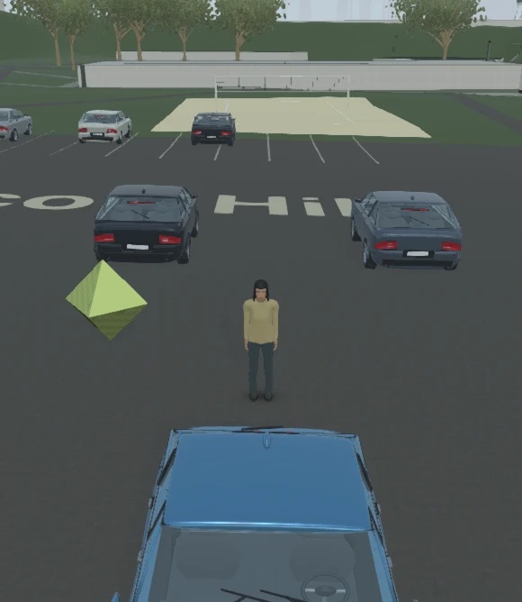

# KEY-52: praktická přejímka herního feedbacku

## Ověřený výsledek

Krátký CZ/EN formulář funguje z menu, docku, F8 i při chybě startu. Snímek vzniká z prvního nového úspěšného běžného renderu, bez dalšího scene.render a bez HTML HUD. Náhled lze odebrat. Nový draft se před Send nepublikuje. Server vrací matching202 až po trvalém uložení a následně soukromě doručuje do Linear. IndexedDB zachovává čekající text i Blob při výpadku a novém načtení.

## Skutečné vzdálené reporty

| Přejímka | Report / Linear | Obraz a důkaz |
|---|---|---|
| První produkční bug | e4068d96-db63-47dc-b781-2e004fc0aa32 / KEY-55 |5114b WebP, remote bytes exact, [readback](live-screenshot-readback.json) |
| Offline idea, zavření klienta a online remount |9c210423-3e46-4410-a679-e9d128033a83 / KEY-56 |27804b WebP, text/ID/Blob zachované, [readback](offline-reload-readback.json) |
| Finální other po review opravách |2e89873e-aafc-4519-a66a-834117b40434 / KEY-57 |28060b WebP, remote bytes exact, [readback](final-readback.json) |

Finální clientBuildId: sha256-86ce14d1b05081a62216221edae812aae0eb8ee824aeadd9b653898ea0c51aa0. Finální image SHA256:23a23beda3872f6c74c6625f35d790f0aabf5a66e1a74c4803639aad490fddf4. Linear issue i obraz byly přečtené nezávisle na workeru; podepsané download URL ani credential se do důkazů neukládají.

[Finální formulář](final-form.jpg), [přijetí](final-accepted.jpg), [browser a konzole](final-browser.json), [trvalé příjemky a nepublikovaný draft](recovery-and-draft-check.json), [skutečný duplicate202/same receipt a conflict409](live-deduplication.json).

## Produkční klient a identita

[Source23badec8 včetně testů](source-acceptance.json), [build a TypeScript](build-acceptance.log), [celá izolovaná integrace](integration-acceptance.log). Visible IAB na Intel UHD630 přes ANGLE D3D11 prošel guest i multiplayerem; finální guest má jinou předlohu Mia, medium,580×668CSS i interně, ready/0render errors. Menu mouse autofocus, Escape návrat na trigger, F8, accepted-reopen autofocus a odebrání fotografie byly ověřené přímo ve hře. Starší [multiplayerový náhled](multiplayer-preview.jpg) má network connected a0errors.

Jeden provozní benchmark před finálními opravami: [10,03s plné hry s HUD](benchmark-before-capture.json),1avatar, pevná medium/denní demo,580×668,38,3FPS,p9532,6ms,p9939,3ms. Není to A/B přínos nebo splnění60FPS na GeForce. Edge timeout při light-preparation je zachovaný v [prvním pokusu](startup-fallback.jpg) a odpovídá dříve doložené baseline odlišnosti; příčina prostředí není prokázaná. Watchdog se neměnil. WebGPU pixely se touto přejímkou netvrdí.

Docker-only oprava později nemění client/server/shared zdroje ani clientBuildId. Přijatý upstream b05a7c4e také nemění tyto runtime vstupy; byte comparison při merge byla prázdná. Přidává pomocný řadič/QA evidenci. Celá kombinace s tímto base dostává vlastní aktuální CI a project-acceptance v [PR19](https://github.com/Varnahg/StrahovCrazyShow/pull/19); stav hlavní integrace je vedený také v [KEY-52](https://linear.app/gigeconomy/issue/KEY-52/implementovat-herni-feedback-se-snimkem-bez-hud-a-dorucenim-do-linear).

## Testy a neúspěšné iterace

- Původní Windows full suite byla přerušena bez úplného výsledku: [stav](local-suite.json), [log](tests.log). Není PASS.
- První kompletní PR CI39501641580:1830testů,1829PASS/1FAIL/0skip. Selhala stará HUD aserce7vs8; [původní log](ci-first-39501641580.log) zůstává. Oprava zachovává explicitní počet a doplňuje CZ/ENfeedbacklabel+F8. Cílený HUD2/2PASS.
- PR CI39502968333/head791e61a1:1830/1830PASS,0fail/0skip, včetně skutečného Chromium/React/nativeIndexedDB/offline/close/reload/exactbytes/receipt/focus testu. [Přesné joby](ci-pass-39502968333.json), [úplný log](ci-pass-39502968333.log). Build i izolovaná integrace PASS; source-secret-hygiene oba běhy PASS.
- Finální kombinovaná PR CI39508452537/head c0098509/base b05a7c4e: **1852/1852 PASS, 0 fail/skip**, skutečný native browser test, produkční build a izolovaná integrace PASS. [Joby](ci-final-pr-39508452537.json), [úplný log](ci-final-pr-39508452537.log). Oba hygiene běhy39508452566/39508444733 PASS. [Přijetí integrátorem](https://github.com/Varnahg/StrahovCrazyShow/pull/19#issuecomment-6303340329) je vázané na přesný head/base; PR19 byl sloučen jako c3454da45b22ad9726c257d3d481d45f6243ec04 bez bypassu.
- [Cílený finální běh](targeted-acceptance.log):89testů,88PASS,0FAIL,1platformní skip nativního browser wrapperu. Obsahuje feedback/identity/capture i HUD; nový pnpm CLI test má8/8deployment testů a jeho negativní kontrola selže podle očekávání. Native browser wrapper mimo Linux CI může být platformní skip; skutečný CI test výše proběhl, žádný skip není vydávaný za PASS.
- Tři nezávislé review vrstvy měly10přijatých oprav/regresí; každá má verdikt v [SPEC](../../../_bmad-output/implementation-artifacts/player-feedback-20261020/SPEC.md). Následný úzký Docker review neměl doložené nálezy. [Výzkum a volba opravy](../../../_bmad-output/implementation-artifacts/player-feedback-20261020/DOCKER-DECISION.md).

Raw logy se neformátují; původní trailing spaces/koncové řádky nejsou měněné kvůli diff-checku.

## Docker a lifecycle

Původní pokus [Docker build](docker-smoke-up.log) reprodukoval implicitní pnpm11.25 reinstalaci/NO_TTY. [Diagnostický build](docker-diagnostics.log) přesně vypsal Patches were modified. Scoped false pouze v Docker RUN po frozen install odstraní další instalaci; balíčky, lock, allowBuilds ani globální nastavení se nemění. Úspěšný [image/up](docker-smoke-up-fixed.log) a [runtime](docker-up.json): user node, healthy, jeden zapisovatelný named volume na/data/feedback, skutečnýPOST202 a přesný privátní diskový report.

[Compiled frontend admission přes CUA](docker-admission.json) potvrdil network connected. Jde o připojení klienta, nikoli GPU-ready/FPS claim. CLI bylo použité pro HTTP/SDK a lifecycle, veškeré lokální UI kroky šly přes CUA. Původní plný test:docker byl před CLI browser phase zastaven a je zachovaný jako přerušený, nikoli PASS: [log](docker-acceptance.log).

[Náhradní skutečný lifecycle](docker-lifecycle.json) prošel běžnými HTTP/assets/cache/guest/matchmaking/SDK scénáři, SIGTERM odpojil oba klienty, kontejner exit0/noOOM. Po restartu zůstal obsah reportu i matching receipt totožný, replay202 prošel a starý svět/session token byl odmítnut. [Původní log lifecycle](docker-smoke-lifecycle.log), [úplný Docker log](docker-smoke.log), [image identity](docker-image.json).

[Cleanup](docker-cleanup.json) odstranil pouze ověřený jedinečný testovací projekt a jeho přesný volume po kontrole jména/labels/driver/options. Vlastní CUA karty, procesy, SDK peers i testovací listenery jsou ukončené. Žádný cizí proces/volume ani původní sdílený dirty checkout nebyl upravený.

## Credential

Dodaný klíč je pouze v ignorované ACL-omezené lokální serverové konfiguraci. Hodnota není v těchto důkazech. [Kontrola38textových souborů finálního dist](dist-secret-acceptance.json) ji nenašla; vlastní staged bajty byly kontrolované také před každým push. Server předává credential pouze oficiálnímu Linear API v Authorization, browser jej nedostává.

[Finální source manifest po připojení přijatého main](source-final.json) zahrnuje i testy a podpůrný řadič. Runtime asset working tree byl při přejímce beze změn vůči Git; veřejné herní modely a textury byly skutečně načtené, žádná geometrie se neregenerovala. [Docker-fix PR CI](ci-docker-39506532996.json) a [log](ci-docker-39506532996.log) zachovávají ověření samostatného opraveného checkpointu; aktuální kombinace s novým main má vlastní finální přijetí v PR19.

## Omezení autorských zdrojů pro následné výkonové srovnání

Následná úplná parity kontrola koordinátora zjistila deset autorských LFS pointerů v této místní kopii: source-plan.json, dva Blender mastery a sedm původních 8K travních textur. [Přímý lokální LFS preflight](local-lfs-authoring-limits.log) tento stav potvrzuje: 12 kontrolovaných souborů, 10 selhání, exit1. Nejde o vstupy používané klientským buildem ani načítané runtime modely/textury. Těchto deset podkladů se v této přejímce neregenerovalo ani nepoužilo pro Blender; herní zpětná vazba má výše vlastní skutečný produkční obraz a přesné vzdálené bajty. GitHub CI samostatně provádí LFS checkout a preflight nad skutečným head.

Původní performance snapshot4654f71c proto není přijatý jako úplná source/asset baseline pro další A/B, i když zbývajících8547 vstupů včetně runtime a testů bylo shodných. Koordinátor vytváří nový snapshot ze své main kopie s úplnými autorskými soubory. Tato evidence nedokládá celkový výkonový přínos a neoznačuje pointery za materializované assets.

Náhradní úplná baseline koordinátora pro main c3454da4 má source ID `f3b5b5c0ba9b2fb5158ee2e1ab17c8b622b86c36fe2150d36bb5d4324ed1034d`: 8557 souborů, before/after/frozen shoda a všech12 LFS file SHA odpovídá Git LFS OID. Manifest je v jeho vlastní rezervované performance cache; nejde o opravu nebo přepsání této místní kopie a samotná příprava baseline není A/B měření.

## Uzavřená integrace

Skutečný main c3454da45b22ad9726c257d3d481d45f6243ec04 má [CI39509508150](ci-main-39509508150.json) a [úplný log](ci-main-39509508150.log): **1852/1852 PASS, 0 fail/skip**, produkční build a celá izolovaná integrace PASS. Main source-secret-hygiene39509507863 SUCCESS. KEY-52 i přejímkové55/56/57 byly až poté uzavřené jako Done; skutečné issues a obrazy jsou zachované. Samostatný závěrečný dokumentační commit aktualizuje pouze evidenci a task statusy.
